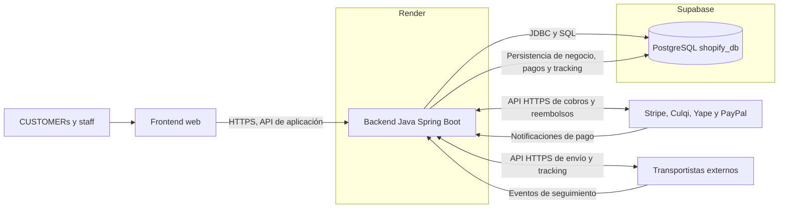
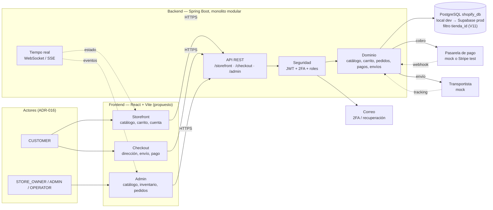

# 00 — Contexto y superficies: Proyecto tipo Shopify vs Shopify real

> Documento consolidado: contiene la respuesta anterior (planteamiento inicial del proyecto) y la última respuesta (investigación sobre si el diagrama representa a Shopify, sobre todo el frontend).

- **Stack:** Dev todo local (PostgreSQL + pgAdmin). Prod final: Spring Boot + Supabase (PostgreSQL) + Render.
- **2FA:** obligatorio para todos los usuarios.
- **Alcance:** plataforma SaaS Multi-Tienda (tenants) y Multi-Sucursal, estilo Shopify (decisión posterior a la Parte 1; la Parte 2 se escribió en época single-store y se conserva como historia).
- **Pagos:** pendiente de decisión (mock vs Stripe / Culqi / PayPal / híbrido).
- **Fecha:** 2026-11-07.

---

## PARTE 1 — Respuesta anterior: planteamiento inicial del proyecto

### 1.1. Objetivo

Construir un e-commerce suficientemente avanzado tipo Shopify, en este orden:

1. Diagramas para entender el diseño actual.
2. Ajustes a la base de datos.
3. Backend.

Usar solo los conceptos de clase necesarios para el proyecto, no todos.

Fuente de verdad de la BD actual:

- `shopify_db/database/01_esquema_shopify.sql` — 54 tablas, 79 FKs, 66 índices explícitos (V1 + migraciones V2–V12).
- `shopify_db/docs/01-arquitectura.md`
- `shopify_db/docs/02-modelo-datos.md`
- `shopify_db/docs/04-reglas-negocio.md`
- `shopify_db/docs/06-seguridad-e-integridad.md`
- `shopify_db/docs/08-observaciones.md`
- `shopify_db/docs/07-datos-prueba.md` (plantilla de seed, sin seed ejecutable)
- `Clases/*.pdf` (Express CRUD, BD relacionales/NoSQL/BaaS, JWT+RBAC, JWT+2FA TOTP, WebSockets)

### 1.2. Decisiones ya tomadas

| Tema | Decisión |
|---|---|
| Backend | Spring Boot |
| BD motor | PostgreSQL |
| Entorno BD | Local dev (pgAdmin) → Supabase en prod |
| 2FA | Obligatorio para todos los usuarios |
| Carpeta diagramas | `diagramas/` en raíz del proyecto, con `README.md` índice |
| Orden de trabajo | Diagramas Mermaid → cambios BD → backend |
| Alcance tienda | SaaS multi-tienda (tenants) + multi-sucursal (V10–V12). Ver `01-arquitectura-frontend.md` y RF-TENANT |

| Tema | Estado |
|---|---|
| Pagos | Pendiente investigación profunda (mock vs Stripe / Culqi / PayPal / híbrido) |
| Acceso a datos Spring | Propuesto JDBC + Flyway, sin decidir |
| Despliegue | Local dev → Render (backend + frontend) + Supabase (BD) en prod |

### 1.3. Diagrama 00 original (línea base)

Este es el diagrama que estaba en `shopify_db/docs/01-arquitectura.md`. Representa una tienda única, no la plataforma Shopify.

Reglas de ese modelo:

- Frontend no accede directo a Supabase ni a credenciales de proveedores.
- Toda escritura pasa por backend con transacciones PostgreSQL.
- `pasarelas_pago` es catálogo local, no implementación.
- `pagos` + `transaccion_externa_id`, `pago_eventos` con `payload` y `referencia_externa`, `reembolsos` ligados a pedido/pago.
- `transportistas` es catálogo local. `envios` + `envio_items` + `envio_eventos` guardan estado actual e historial.
- Sin Redis, sin segunda BD, sin almacén de eventos independiente.
- Despliegue previsto en Render, secretos por variables de entorno.

Problemas de este `00` original:

1. Mezcla CUSTOMER y OPERATOR en un solo `Frontend web` (terminología actualizada por ADR-016; el texto original decía "comprador y operador").
2. No separa Storefront / Admin / Checkout (decisión final: se mantiene Supabase + Render).
4. Expone una sola API genérica en vez de namespaces por superficie.

### 1.4. Propuesta de BD v2 (pendiente de aplicar)

#### `usuarios` (añadido en V2 — aplicado)

- `email_verificado`, `totp_secret`, `totp_habilitado`, `totp_confirmado_en`, `intentos_fallidos`, `bloqueado_hasta`, `ultimo_acceso`.

#### `sesiones` (endurecidas en V8 — aplicado)

- `token` renombrada a `token_legacy` (en transición hasta el cutover).
- Añadidos `token_hash`, `familia_id`, `revocado_en`, `reemplazado_por_id`, `motivo_revocacion` (rotación estilo Shopify).

#### Tablas nuevas (V2 aplicó `usuario_codigos_recuperacion`; V15 `tokens_cuenta`, V16 `notificaciones` — aplicadas)

- `usuario_codigos_recuperacion` (backup codes 2FA) — aplicada en V2.
- `tokens_cuenta` (verificación email / reset password) — aplicada en V15.
- `notificaciones` (eventos para el staff) — aplicada en V16.

#### `pedidos` (contacto y notas — aplicado en V17)

- `email_contacto`, `telefono_contacto`, `notas_cliente` (también en `checkout_sesiones`; el pedido los copia al confirmar).

#### Integridad propuesta

- Inventario: evitar stock negativo / doble reserva.
- Direcciones de pedido inmutables (snapshot).
- `envio_items` ligados a artículos del pedido.
- Descuentos de pedido consistentes.
- Reviews solo de compras válidas.
- Wishlist sin duplicados.
- Referencias de pago únicas por pasarela.
- Totales y descuentos recalculables.
- Cronología coherente (creado → pagado → enviado → entregado).
- Triggers para `actualizado_en` — aplicado en V7.

#### Seed propuesto

- Roles: `admin`, `operador`, `cliente`. (Histórico pre-B; canónicos en ADR-016: STORE_OWNER/ADMIN/OPERATOR/SUPER_ADMIN/CUSTOMER.)
- Usuarios demo, catálogo, inventario, cupones, gateway mock, carrier mock.

### 1.5. Secuencia de diagramas propuesta

1. `00 — Contexto y estado actual`
2. `01 — Modelo de datos por módulos`
3. Auth / 2FA
4. Catálogo / inventario
5. Carrito / checkout / pedido
6. Pagos
7. Envíos
8. Tiempo real
9. Arquitectura backend
10. Despliegue

Propuesta actualizada (ver Parte 2):

1. `00 — Contexto y superficies` (revisado)
2. `01 — Arquitectura frontend` (nuevo, con route trees y llamadas a API)
3. `02 — Modelo de datos por módulos`
4. `03 — Auth + 2FA`
5. `04 — Catálogo e inventario`
6. `05 — Carrito, checkout y pedido`
7. `06 — Pagos`
8. `07 — Envíos`
9. `08 — Tiempo real`
10. `09 — Arquitectura backend`
11. `10 — Despliegue`

---

## PARTE 2 — Última respuesta: ¿este diagrama representa a Shopify? (frontend)

### 2.1. Respuesta corta

No. El diagrama `00` no representa a **Shopify como plataforma**: representa **una tienda única “tipo Shopify”**, que es lo que un merchant ve y opera. Y la caja `Frontend web` es la parte que más se aleja de la realidad: Shopify no tiene un solo frontend, tiene varias superficies separadas.

Como diagrama de contexto de *nuestro* proyecto sirve, pero está incompleto en un punto: mezcla CUSTOMER y staff en un solo `Frontend web` (decisión final de infra: se mantiene Supabase + Render).

### 2.2. Backend real de Shopify (investigación)

Shopify no es microservicios. Su núcleo es un **monolito modular en Ruby on Rails**:

- Más de 2.8M líneas de Ruby.
- Fronteras entre componentes impuestas con **Packwerk**.
- Datos particionados por `shop_id` en clústeres **MySQL** (pods).
- Renderizado del storefront en capa separada del core.

Es un solo despliegue grande, con módulos internos bien delimitados. Eso es lo que queremos replicar con Spring Boot, pero en pequeño.

### 2.3. Frontend real de Shopify: no es uno, son varios

| Superficie | Tecnología | Usuario | Dónde vive |
|---|---|---|---|
| **Online Store / Storefront** | Tema **Liquid** renderizado por Shopify, o **Hydrogen** (React Router, Next.js, Nuxt, etc.) contra Storefront API | Comprador | Shopify / Oxygen / Vercel |
| **Shopify Admin** | App React con **Polaris** y **App Bridge** | Merchant y staff | Shopify |
| **Checkout** | Hospedado por Shopify; se extiende con **Checkout UI extensions**, Shopify Functions y Web Pixels | Comprador | Shopify |
| **Customer accounts** | Nuevas cuentas hospedadas por Shopify, separadas del tema, con **Customer Account API** | Comprador | Shopify |
| **Apps embebidas** | React + Polaris + App Bridge | Merchant | Servidor del partner |

Puntos clave de la documentación oficial:

- Hydrogen maneja carrito, variantes, colecciones, búsqueda, analytics y rutas que apps y checkout necesitan. El framework (React Router, Next.js, etc.) es dueño del routing, render y UI.
- Hydrogen **no incluye checkout UI, porque checkout sigue en Shopify**.
- `checkout.liquid` fue deprecado en agosto de 2024. El checkout ya no se modifica como tema: se extiende con componentes controlados.
- Las nuevas Customer Accounts son experiencia standalone gestionada por Shopify, separada del tema, similar a Checkout.
- Hydrogen expone contrato estándar de eventos/acciones (`window.Shopify.actions`, eventos `shopify:cart:*`) igual que los temas Liquid, para que apps y agentes lean/actualicen el carrito igual.

APIs:

- **Storefront API** (GraphQL): catálogo, carrito, checkout.
- **Admin API** (GraphQL/REST): merchants y apps.
- **Customer Account API**: identidad e historial del comprador.
- **Webhooks**: pedidos, pagos, inventario, fulfillment.

### 2.4. Comparación con nuestro `00`

| Shopify real | Nuestro `00` | Qué falta |
|---|---|---|
| Storefront (Liquid/Hydrogen) | `Frontend web` | Separar experiencia del comprador |
| Admin (Polaris) | `Frontend web` | Separar superficie administrativa y roles |
| Checkout hospedado | `Frontend web` | Modelarlo como flujo aislado, sin navegación de tienda |
| Customer accounts | `Frontend web` | Cuenta del comprador |
| Monolito modular Rails | Spring Boot | Correcto en espíritu, distinto stack |
| MySQL con pods por `shop_id` | PostgreSQL única | Simplificación single-tenant |
| Oxygen | Render | Equivalente: nuestro despliegue (backend + frontend) |
| Storefront/Admin/Customer APIs | Una sola API | Separar namespaces por superficie |

El problema de fondo es que `Frontend web` mezcla **tres viajes con requisitos distintos**:

- **Storefront:** público, SEO, caché, bundle grande.
- **Checkout:** autenticado, sin caché, datos de pago, máxima seguridad.
- **Admin:** autenticado, roles, 2FA, auditoría, sin SEO.

Eso no es solo visual: cambia guards de rutas, code splitting, namespaces de API y alcance PCI.

### 2.5. Propuesta de `00` revisado

No obliga a desplegar tres apps. Puede ser **un solo SPA con tres route trees** (`/`, `/checkout`, `/admin`) o **dos apps** (storefront + admin). Lo importante es reflejar la separación en diagrama y código.

### 2.6. Qué copiar de Shopify y qué no

**Sí copiar:**

- Separación Storefront / Checkout / Admin / Cuenta.
- Modelo de dominio: productos, variantes, opciones, inventario por ubicación, carrito → checkout → pedido, pagos con webhook e idempotencia, fulfillment, descuentos, reseñas, wishlist, auditoría.
- 2FA para staff (y para clientes, por decisión propia).
- Namespaces de API por superficie.
- Webhooks y eventos para pagos y tracking.

**No copiar:**

- Multi-tenancy estilo `shop_id` (aislado por `tienda_id`, V10–V12).
- Liquid, Oxygen, Rails, MySQL sharding.
- Ecosistema de apps, Shopify Functions, billing.
- Checkout hospedado real: lo simulamos con ruta aislada.

### 2.7. Efecto del 2FA obligatorio

Shopify permite **guest checkout**. Si “2FA obligatorio para todos” incluye invitados, no puede haber checkout invitado: el comprador debe registrarse y configurar TOTP antes de pagar.

Dos caminos:

- **A) Sin guest checkout:** más seguro y coherente con el requisito, más fricción. Recomendado.
- **B) Guest checkout con verificación por email:** más parecido a Shopify, pero contradice “2FA para todos”.

Recomendación: **A**, y documentarlo como desviación deliberada respecto a Shopify.

> Actualización ADR-016: la decisión A sigue vigente para staff, pero queda **derogada para CUSTOMER**: el passwordless por código de email es la vía B (verificación por email) aplicada a compradores.

### 2.8. Pendientes de decisión

1. **Frontend:** ¿un solo SPA con tres route trees, o dos apps separadas (storefront + admin)?
2. **Diagrama `01`:** ¿agregar `01 — Arquitectura frontend` o solo revisar `00`?
3. **Guest checkout:** ¿A o B?
4. **Pagos:** propuesta pendiente — **mock con interfaz adaptador primero, Stripe test después**, para no bloquear backend.
5. **Acceso a datos Spring:** JDBC + Flyway propuesto, sin decidir.

---

## Fuentes

- [Under Deconstruction: The State of Shopify's Monolith](https://shopify.engineering/shopify-monolith)
- [Hydrogen (docs actuales)](https://shopify.dev/docs/storefronts/hydrogen)
- [Hydrogen and Oxygen fundamentals (legacy)](https://shopify.dev/docs/storefronts/headless/legacy/hydrogen/fundamentals)
- [Checkout UI extensions](https://shopify.dev/docs/api/checkout-ui-extensions/latest)
- [Customer accounts](https://help.shopify.com/en/manual/customers/customer-accounts)
- [Customer Account API](https://shopify.dev/docs/api/customer/latest)
