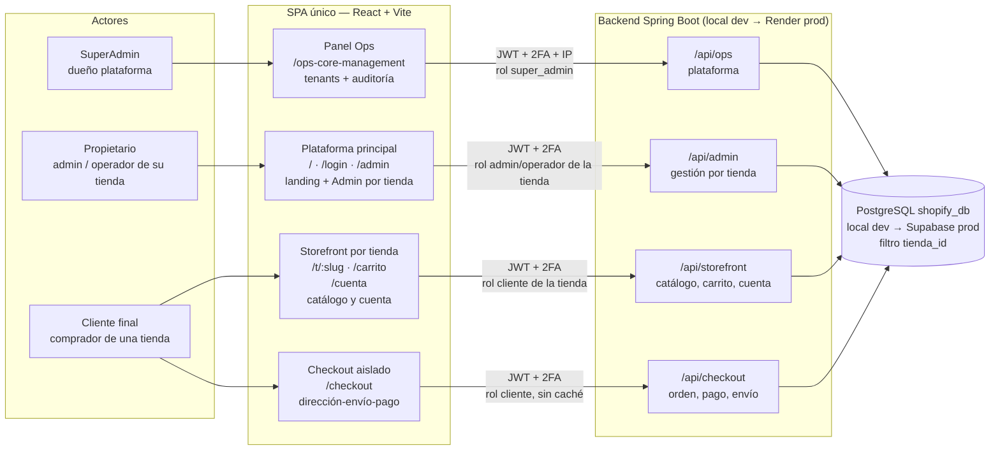
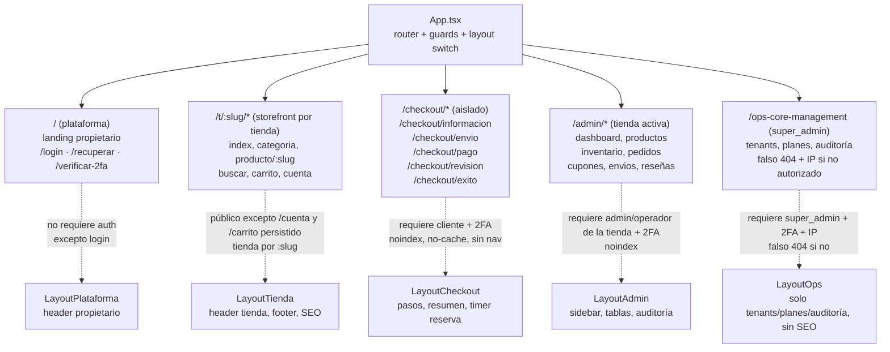
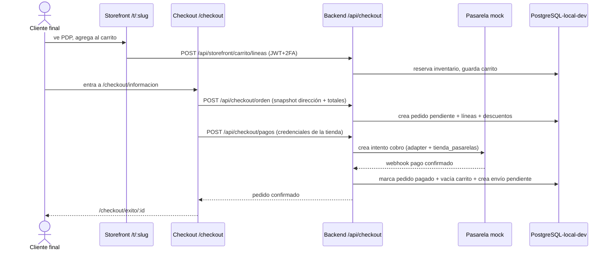

# 01 — Arquitectura frontend: Plataforma multi-tienda, Storefront y Ops

- **Decisión frontend:** un solo SPA (React + Vite propuesto), dev en local.
- **Stack:** Dev todo local (PG + pgAdmin). Prod final: Spring Boot (Render) + Supabase Postgres.
- **Alcance:** SaaS multi-tienda (tenants) y multi-sucursal. Storefront por tienda (`/t/:slug`).
- **Idea del usuario:** la página principal es solo del propietario, no es para clientes finales. Los clientes solo ven tienda/checkout en el Storefront.
- **Fecha:** 2026-11-07.

## 1. Traducción a requerimientos funcionales

Sí, lo que describes sí se entiende como RF. Lo formalizo así:

### Actores

- **SuperAdmin:** dueño del software/plataforma. Usa el panel Ops (`/ops-core-management`). Ve lista y agregados de tiendas, nunca sus datos internos.
- **Propietario:** admin (dueño) / operador (empleado) de SU tienda. Usa la plataforma principal + Admin de su tienda. No compra.
- **Cliente final (cliente de tienda, no propietario):** compra en el Storefront de una tienda. No entra al Admin.

### RF Plataforma principal (solo propietario, por tienda)

- `RF-PLAT-01`: landing/marketing de la plataforma solo orientada al propietario.
- `RF-PLAT-02`: login propietario con 2FA TOTP obligatorio.
- `RF-PLAT-03`: recuperación de cuenta (email + backup codes).
- `RF-PLAT-04`: acceso a `/admin` solo con rol `admin` / `operador` de ESA tienda + 2FA verificado.
- `RF-PLAT-05`: el propietario gestiona el catálogo, inventario, pedidos, cupones, envíos, reseñas (moderar) y usuarios de SU tienda; jamás ve otra.
- `RF-PLAT-06`: el propietario NO compra desde la plataforma principal.

### RF Ops (solo super_admin — dueño de la plataforma, alcance estilo org-admin Plus)

- `RF-OPS-01`: panel en ruta ofuscada `/ops-core-management` (falso 404 + IP si no autorizado; excepción deliberada, Shopify no ofusca).
- `RF-OPS-02`: tenants — ver lista y métricas agregadas (plan, estado, ingresos totales), suspender/reactivar por compliance con motivo registrado + apelaciones, transferir dueño. Prohibido leer o modificar pedidos, clientes, productos o credenciales de tiendas.
- `RF-OPS-03`: negocio — ver planes por tenant, ingresos (MRR, trials, churn, suspendidos), crear/editar planes y precios sin tocar código.
- `RF-OPS-04`: plataforma — usuarios y roles del equipo, pasarelas globales habilitadas, feature flags, modo mantenimiento y anuncios.
- `RF-OPS-05`: soporte — si un merchant pide ayuda, él mismo otorga un rol `operador` temporal en SU tienda (él lo concede y revoca, todo auditado). El `super_admin` nunca entra directo a tiendas.

### RF Storefront (solo cliente final)

- `RF-STORE-01`: home, catálogo, búsqueda, detalle producto (PDP), solo accesibles en zona Storefront.
- `RF-STORE-02`: carrito en Storefront.
- `RF-STORE-03`: checkout en layout aislado (sin nav de tienda, sin links a admin).
- `RF-STORE-04`: registro cliente + 2FA obligatorio (decisión A: sin guest checkout).
- `RF-STORE-05`: cuenta cliente: perfil, direcciones, pedidos, tracking, wishlist, reseñas propias.
- `RF-STORE-06`: el cliente NO ve ni entra al Admin ni a la landing del propietario como funcionalidad.

### Regla de separación

> Todo lo comprable (`/t/:slug/*`, `/checkout/*`) vive solo en el Storefront de cada tienda. Todo lo gestionable (`/admin/*`) vive solo en la Plataforma de esa tienda. El panel Ops (`/ops-core-management`) es otra zona aparte. Comparten el mismo SPA desplegado, pero no comparten layout, nav, guards ni llamadas API. El `tienda_id` se deriva de la identidad + slug, nunca del request manipulable.

## 2. Diagrama de contexto: dos frontends lógicos, un despliegue



Lectura estilo Shopify real:

- `LAND + /admin` = equivalente a `shopify.com` + Shopify Admin (Polaris), por tienda.
- `STORE + CHECK` = equivalente a Online Store (Liquid/Hydrogen) + Checkout hospedado + Customer Accounts, por tienda.
- `OPS` no tiene equivalente Shopify (ellos no ofuscan): es nuestra excepción como dueños simulados de la plataforma.
- Nosotros lo desplegamos como un solo SPA, pero lógicamente son tres productos.

## 3. Árbol de rutas del SPA único



### Detalle de rutas propuesto

```text
/                          -> LandingPlataforma (solo propietario, marketing + entrar)
/login                     -> Login (selector rol, luego 2FA)
/verificar-2fa              -> VerificarTOTP
/recuperar                 -> RecuperarCuenta
/t/:slug                 -> HomeTienda (tienda por slug)
/t/:slug/c/:categoria     -> PLP
/t/:slug/p/:slug          -> PDP
/t/:slug/buscar?q=        -> Búsqueda
/t/:slug/carrito          -> Carrito
/t/:slug/cuenta/*         -> Perfil, direcciones, pedidos, tracking, wishlist
/checkout/informacion      -> Email, dirección (snapshot)
/checkout/envio            -> Método envío / carrier mock
/checkout/pago             -> Método pago (credenciales de la tienda)
/checkout/revision         -> Revisión + crear pedido
/checkout/exito/:id        -> Confirmación (limpia carrito)
/admin                     -> Dashboard (tienda activa)
/admin/productos...        -> CRUD catálogo (solo su tienda)
/admin/inventario...       -> Stock por ubicación
/admin/pedidos...          -> Pedidos, fulfillment, reembolsos
/admin/cupones...          -> Descuentos
/admin/envios...           -> Envíos y tracking
/ops-core-management       -> Panel plataforma (super_admin; falso 404 + IP si no)
```

## 4. Flujo de compra solo en Storefront (sequence)



La plataforma principal (`/` y `/admin`) nunca aparece en este flujo. Esa es la garantía de tu requisito.

## 5. Guards y seguridad por zona

| Zona | Auth | Layout | API | Caché/SEO |
|---|---|---|---|---|
| `/`, `/login` | público | Plataforma | `/auth/*` | SEO solo landing |
| `/t/:slug` pública | pública (lectura) | Tienda | `/api/storefront` GET + `tienda_id` | SEO sí, caché CDN sí |
| `/t/:slug/cuenta`, `/carrito` | cliente de la tienda + 2FA | Tienda | `/api/storefront` | no-cache, noindex cuenta |
| `/checkout/*` | cliente + 2FA obligatorio | Checkout aislado | `/api/checkout` | `noindex, no-store`, sin nav tienda |
| `/admin/*` | admin/operador de la tienda + 2FA | Admin | `/api/admin` | `noindex, no-store`, auditoría |
| `/ops-core-management` | super_admin + 2FA + IP | Ops | `/api/ops` | `noindex, no-store`, falso 404 si no autorizado |

Reglas:

- Un JWT de `cliente` no abre `/admin`. Un JWT de `admin` no compra en `/checkout` (se bloquea por rol para evitar auto-pedidos del propietario).
- Toda query lleva `tienda_id` derivado de la identidad + slug; jamás se acepta del request sin validar (anti-fuga, RF-TENANT-02).
- Checkout no precarga bundles de Admin y viceversa (code splitting por route tree).
- Tokens en `HttpOnly + Secure + SameSite=Lax`, rotación en `sesiones` (`token_hash`, `familia_id`, `revocado_en`).
- 2FA TOTP: login password → challenge TOTP → JWT corto + refresh rotado. Backup codes en `usuario_codigos_recuperacion`.

## 6. Llamadas API por superficie

```mermaid
flowchart TB
    subgraph FE0["Panel Ops"]
        O1["GET /api/ops/tiendas"]
        O2["GET /api/ops/auditoria"]
    end
    subgraph FE1["Plataforma / Admin"]
        A1["GET /api/admin/pedidos"]
        A2["PATCH /api/admin/inventario"]
        A3["POST /api/admin/productos"]
    end
    subgraph FE2["Storefront"]
        S1["GET /api/storefront/productos?q"]
        S2["GET /api/storefront/productos/:slug"]
        S3["POST /api/storefront/carrito/lineas"]
        S4["GET /api/storefront/cuenta/pedidos"]
    end
    subgraph FE3["Checkout"]
        C1["POST /api/checkout/orden"]
        C2["POST /api/checkout/envio/cotizar"]
        C3["POST /api/checkout/pagos"]
        C4["POST /api/checkout/confirmar"]
    end
    BE["Backend Spring Boot (local dev → Render prod)<br/>valida rol + tienda + 2FA + totales + stock"]

    O1 & O2 --> BE
    A1 & A2 & A3 --> BE
    S1 & S2 & S3 & S4 --> BE
    C1 & C2 & C3 & C4 --> BE
```



Esto replica la idea Shopify de Storefront API vs Admin API vs Customer Account API, pero con REST y namespaces propios.

## 7. Qué implica “un solo SPA”

**Ventajas:**

- Un despliegue, un router, un sistema de login/2FA.
- Reutilizas componentes UI (botones, tablas, formatos dinero).
- Más rápido para el curso/proyecto.

**Costos y mitigaciones:**

- Riesgo de mezclar bundles admin/tienda → mitigar con `lazy()` por route tree.
- Riesgo de que un cliente adivine `/admin` → mitigar con guards + 401/403 del backend (el frontend no es seguridad).
- Checkout debe verse aislado aunque comparta repo → layout distinto, sin header/footer de tienda, sin links cruzados.

Si más adelante el bundle pesa, se puede partir en dos apps (`storefront` + `admin`) sin cambiar backend, porque ya están separados los namespaces `/api/*`.
