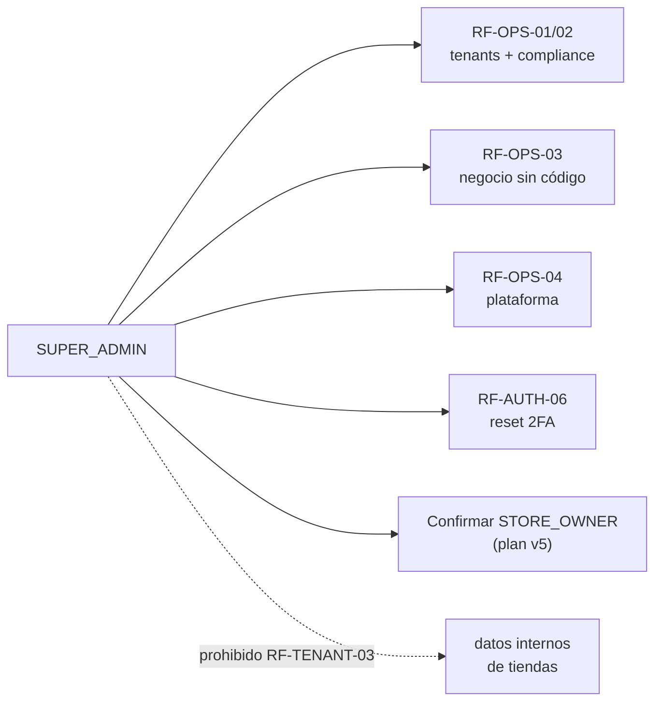
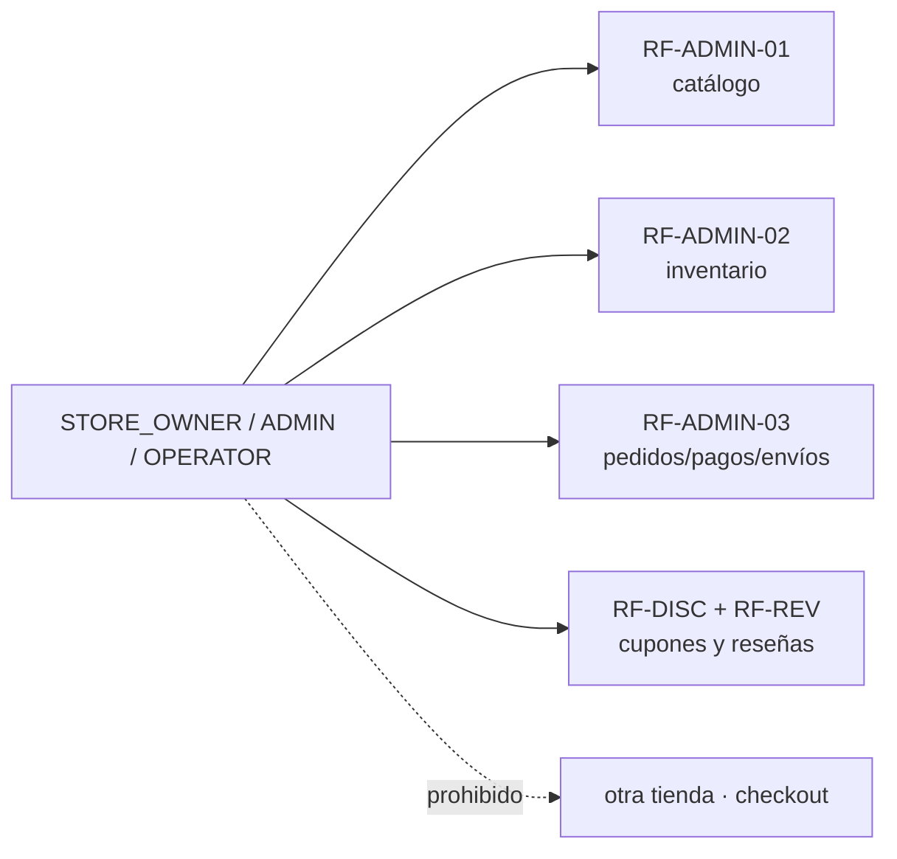
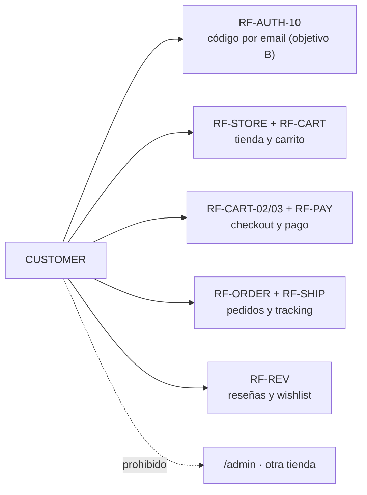

# 02 — Casos de uso por actor (mapa; el detalle vive en `10-requerimientos.md`, canónicos en ADR-016)

## SUPER_ADMIN (plataforma)

## STORE_OWNER / ADMIN / OPERATOR (de su tienda)

## CUSTOMER (de una tienda)

## Secuencia propuesta de diagramas

- `02` casos de uso (este) → `03` clases de dominio → `04` secuencia auth+2FA → `05` secuencia carrito/checkout/pedido → `06` secuencia pagos+webhooks → `07` secuencia envíos → `08` componentes backend.
