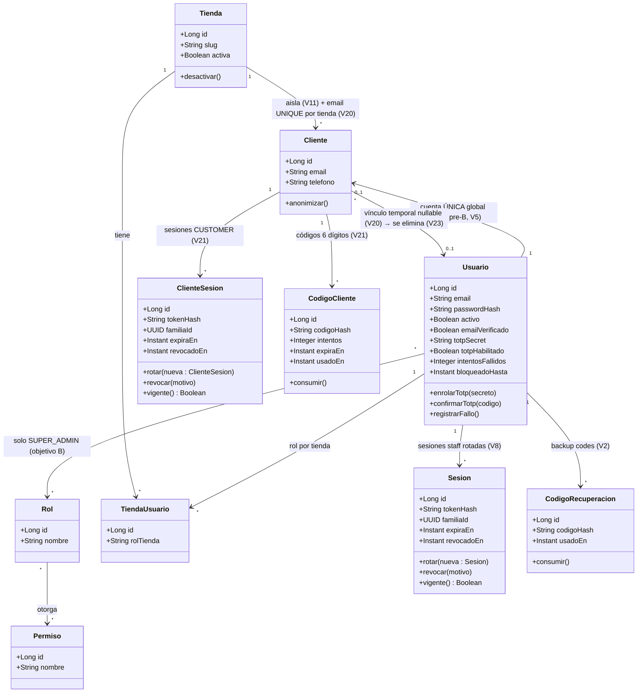

# 03 — Clases de dominio: Auth, tenants y usuarios (base: `02-modelo`, `03-diccionario`, V2/V5/V8/V12; objetivo B: V20–V23, ADR-016)

Notas:
- SUPER_ADMIN no es clase: es fila en `roles` + `usuario_roles` global (V12, se mantiene).
- Actual pre-B: `Cliente` implica rol global `cliente` en su tienda; `TiendaUsuario` solo `admin`/`operador`.
- Objetivo B (ADR-016): CUSTOMER sin fila en `usuario_roles`; `TiendaUsuario.rol_tienda` admite `store_owner` (exactamente 1 por tienda, V22) / `admin` / `operador`; mismo email permitido en ambos mundos sin vínculo.
- `token_legacy` no se modela: existe solo hasta el cutover V8.
