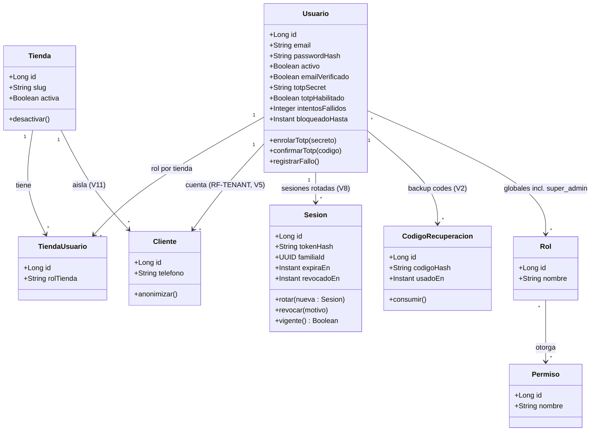

# 03 — Clases de dominio: Auth, tenants y usuarios (base: `02-modelo`, `03-diccionario`, V2/V5/V8/V12)

Notas:
- `super_admin` no es clase: es fila en `roles` + `usuario_roles` global (V12).
- `Cliente` implica rol cliente en su tienda; `TiendaUsuario` solo `admin`/`operador`.
- `token_legacy` no se modela: existe solo hasta el cutover V8.
