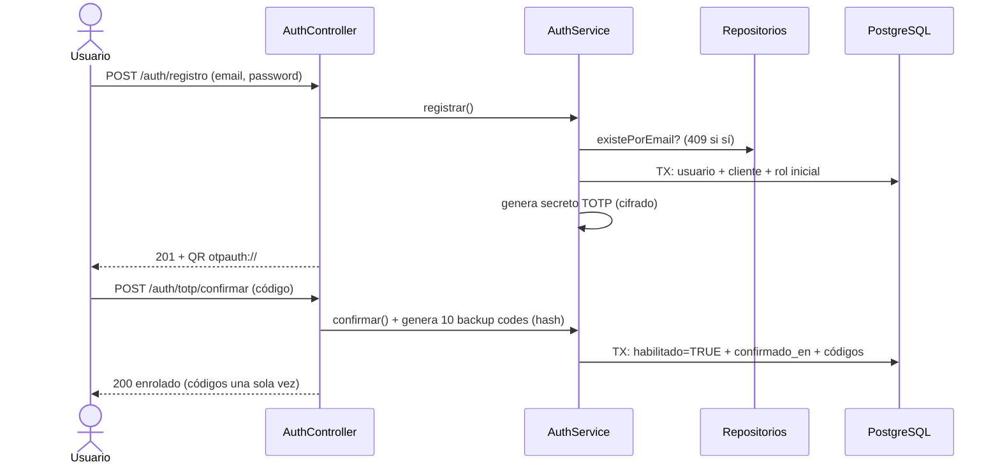
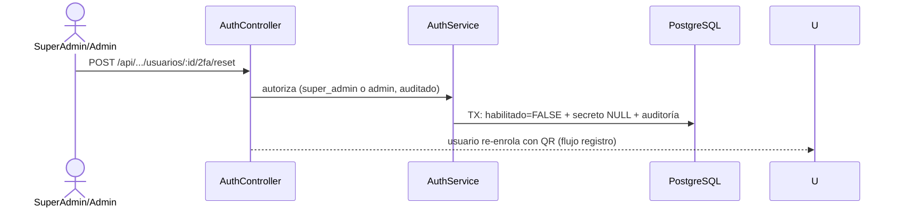

# 04 — Secuencia Auth + 2FA (base: RF-AUTH, Flujo 1 de `05`, V2/V8)

## Registro + enrolamiento



## Login + refresh

```mermaid
sequenceDiagram
    actor U as Usuario
    participant C as AuthController
    participant S as AuthService
    participant D as PostgreSQL

    U->>C: POST /auth/login (email, password)
    C->>S: passwordOK? (genérico si no, +intento, bloqueo si toca)
    S->>S: email verificado? (409 si no; enrolar sí pudo antes)
    C-->>U: 200 challenge TOTP requerido
    U->>C: POST /auth/totp/verificar (código o backup code)
    C->>S: verifica (ventana ±1 o hash + usado_en)
    S->>D: TX: resetea intentos + ultimo_acceso + sesión (token_hash, familia nueva)
    C-->>U: JWT 15min + refresh opaco (HttpOnly)
    U->>C: POST /auth/refresh (refresh)
    C->>S: hash vigente y no revocado?
    S->>D: TX: revoca vieja (reemplazado_por) + crea nueva misma familia
    C-->>U: JWT + refresh nuevos
    Note over C,D: reuso de refresh rotado = revocar familia entera
```

## Reset admin (RF-AUTH-06)



## Verificación email + reset (RF-AUTH-07, V15 `tokens_cuenta`)

```mermaid
sequenceDiagram
    actor U as Usuario
    participant C as AuthController
    participant S as AuthService
    participant D as PostgreSQL

    U->>C: POST /auth/registro (email, password)
    C->>S: registrar() + emite token verificación (24h, solo hash)
    S->>D: TX: usuario + cliente + rol + token_cuenta
    S-->>U: correo con código (Resend HTTPS)
    U->>C: POST /auth/email/confirmar (código)
    C->>S: tipo + vigente + un solo uso?
    S->>D: TX: email_verificado=TRUE + usado_en
    U->>C: POST /auth/password/solicitar (email)
    C-->>U: 204 genérico (no revela si existe)
    S->>D: TX: invalida previos + token reset (60min)
    U->>C: POST /auth/password/confirmar (código + nueva)
    S->>D: TX: password nuevo + revoca sesiones + usado_en
    Note over C,D: re-solicitar invalida el anterior; reuso = 401
```
