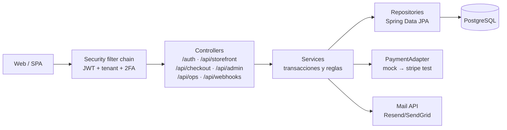

# 08 — Componentes backend (base: RF, secuencias 04–07, scaffold `backend/`)

## Capas y request flow



## Paquetes `src/main/java/...` (por módulo, decisión cerrada)

```text
com.tienda.plataforma
├── auth/          identidad, sesiones, TOTP, roles globales
│   └── entity/    Usuario, Rol, Permiso, Sesion, CodigoRecuperacion
├── tenants/       tiendas, membresías, clientes
│   └── entity/    Tienda, TiendaUsuario, Cliente
├── catalogo/      catálogo por tienda
│   └── entity/    Proveedor, Producto, ProductoOpcion, ...
├── inventario/    stock por ubicación (sucursales)
│   └── entity/    Ubicacion, ArticuloInventario, NivelInventario, ...
├── venta/         carrito, checkout, pedidos (pendiente)
├── pagos/         pagos, adapter mock (pendiente)
├── envios/        envíos y tracking (pendiente)
├── platform/      ops super_admin (pendiente)
└── shared/        config, security (JwtFilter, TenantFilter),
                   exception, mail (pendiente)
```

Cada módulo tendrá sus `controller/`, `service/`, `repository/`, `dto/` al codificarlo. Regla: dependencias solo hacia `shared` o hacia abajo (venta → catalogo/tenants/auth); jamás entre iguales sin servicio intermedio.

## Pendiente del scaffold actual (actualizado)

- ✅ Deps en `pom.xml`: web, security, data-jpa, validation, flyway-core + database-postgresql, driver PG, googleauth TOTP.
- ✅ Paquete `com.tienda.plataforma` + perfiles `local`/`prod` (`DATABASE_URL` por entorno).
- ✅ `V1__base.sql` como copia congelada para Flyway; V2+ vía `spring.flyway.locations`.
- Falta: entidades, repositorios, servicios, controladores y suite de concurrencia.
