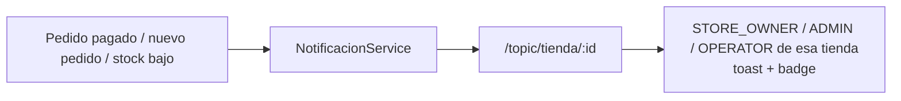

# 09 — WebSocket: solo campana staff (investigado, no inventado)

**Veredicto de investigación (doc oficial Shopify):** Shopify no expone WS público. Notificaciones a staff por email/push, timeline como log en BD, checkout síncrono, tracking por polling al carrier, realtime oficial = webhooks. Internamente migraron su mapa BFCM de WS a SSE por ser unidireccional.

**Alcance implementado (único):** campana del staff por tienda.

- Handshake `/ws` exige JWT (`Authorization` o `?token=`); sin él no hay conexión.
- Suscripción solo a `/topic/tienda/:id` siendo miembro (STORE_OWNER/ADMIN/OPERATOR); SUPER_ADMIN excluido (RF-TENANT-03).
- 5 eventos: `nuevo_pedido`, `pedido_pagado`, `pedido_cancelado`, `pedido_entregado`, `stock_bajo`.
- Todo lo demás (checkout, tracking CUSTOMER, sync) por polling/webhooks, como Shopify.

## Bandeja persistente (V16, RF-ADMIN-05)

El WS es efímero: si el staff está offline pierde el aviso. Cada evento se
guarda además en `notificaciones` (fuente) en la misma transacción del flujo,
como la auditoría. La bandeja (`GET /api/admin/notificaciones`,
`GET /api/admin/notificaciones/no-leidas`, `PATCH .../{id}/leer`) lee esa
tabla, aislada por tienda (aviso ajeno = 404). El mensaje WS lleva el `id`
de la fila para correlacionar.
