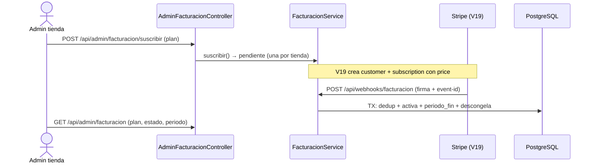
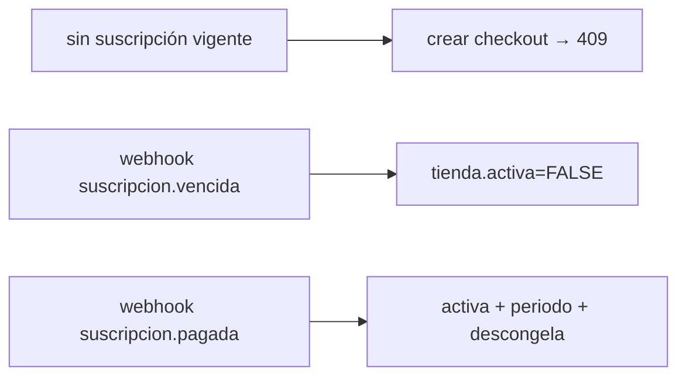

# 10 — Facturación de plataforma (base: RF-BILL, V18)

- Suscripción POR `tienda_id` (una activa; mensual 30d / anual 365d), con nuestras llaves —no las de la tienda (decisión Billing Shopify en `AGENTS.md`).
- Dinero del comprador nunca a nuestra cuenta: cada tienda cobra en SU pasarela (V10).
- Impago = congelar (`activa=FALSE`: sin checkout nuevo), nunca DELETE con historial.
- Cobro Stripe real V19: customer + subscription con price del plan al suscribir (llaves de plataforma por entorno); `invoice.payment_succeeded` renueva, `customer.subscription.deleted` cancela y congela; sin configurar queda pendiente (verificado con stub).