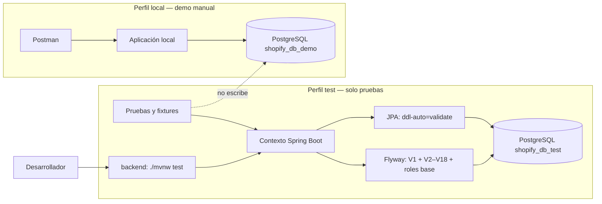

# 11 — Aislamiento de pruebas automatizadas

- **Objetivo:** ejecutar pruebas de integración sin escribir en la BD usada por Postman.
- **BD de pruebas:** PostgreSQL local `shopify_db_test`.
- **BD de demo:** `shopify_db_demo`, reservada para la aplicación local y el recorrido Postman.
- **Migraciones:** Flyway aplica V1 del classpath, V2–V18 desde `shopify_db/database/migrations` y `R__roles_base`.
- **Regla:** los fixtures persistentes de pruebas solo pueden quedar en `shopify_db_test`; no recrear ni limpiar `shopify_db_demo` como parte de `mvn test`.



## Operación esperada

La primera instalación local crea la BD vacía una sola vez, conectado a `postgres`:

```sql
CREATE DATABASE shopify_db_test OWNER postgres;
```

No volver a ejecutar esa sentencia si ya existe la BD.

1. Las clases de integración activan el perfil `test`; su datasource apunta por defecto a `shopify_db_test`.
2. Flyway migra la BD de pruebas desde cero al iniciar el contexto Spring.
3. Los tests pueden usar fixtures transaccionales o persistentes; cualquier residuo queda aislado en la BD de pruebas.
4. Ejecutar Maven desde `backend/`, porque la ubicación filesystem de V2+ es relativa al directorio de trabajo.
5. La BD demo se conserva para Postman. No se configura como destino de Maven ni se elimina durante las pruebas.
