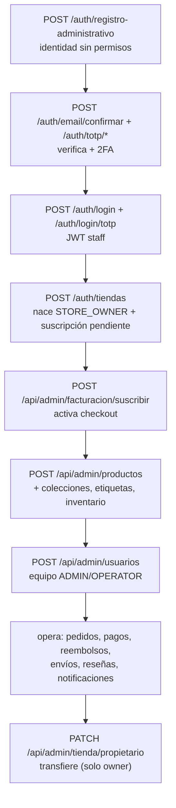
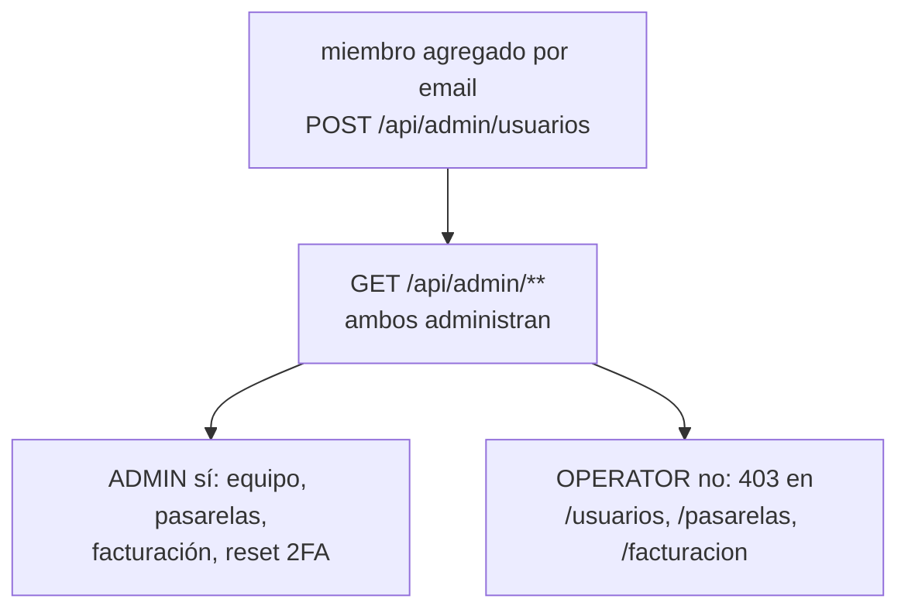
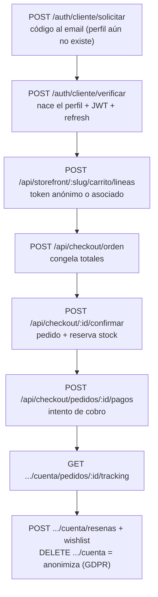
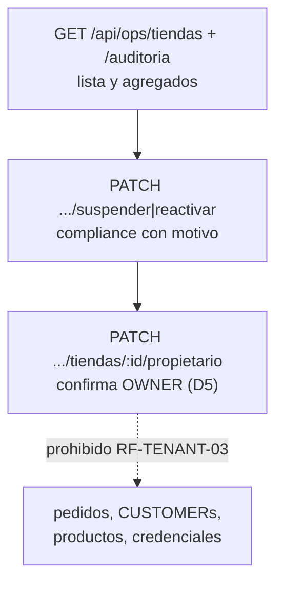

# 13 — Flujos punta a punta por rol (ADR-016 aplicado en F4)

Un diagrama por actor con endpoints reales. Guards: JWT staff (`aud=tienda-admin`)
vs CUSTOMER (`aud=tienda-storefront`); tenant por slug/header (`12`).

## STORE_OWNER — de crear la tienda a transferirla

## ADMIN / OPERATOR — operar la tienda (sin ser dueños)

## CUSTOMER — comprar con passwordless

## SUPER_ADMIN — plataforma, nunca tiendas por dentro

## Reglas cruzadas

- JWT CUSTOMER nunca abre `/api/admin`; JWT staff nunca compra en `/checkout`.
- Mismo email permitido en ambos mundos, incluso en la misma tienda, sin
  compartir credenciales, sesiones ni permisos.
- Nada se borra con historial: cancelar/archivar/desactivar/anonimizar.
