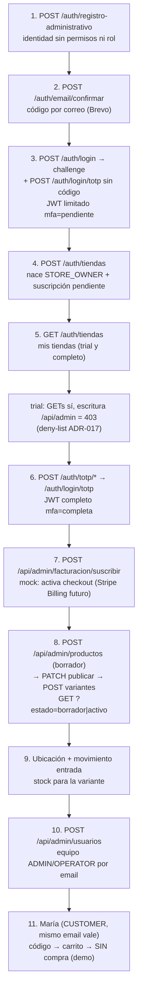
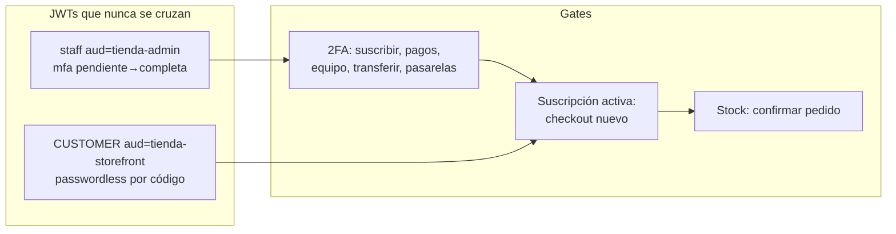

# 14 — Recorrido demo STORE_OWNER (todo lo construido, ADR-016/017)

Un solo diagrama para exponer: del registro a la tienda vendiendo (trial),
con endpoints reales y guards. Demo actual: Postman (78) + SPA staff.

## Guion demo (15 min)

1. Registro → código Brevo → trial → crear `tienda-paz` (Postman Auth o SPA).
2. Probar el 403 escribiendo con limitada; enrolar 2FA inline; insignia Completa.
3. `GET /auth/tiendas` (la lista), suscribir mock, crear + publicar Gorra + variante + stock.
4. Agregar admin/operador por email (el invitado ya registrado).
5. María con el mismo email: código → carrito con 2 Gorras → ver carrito (sin comprar).

## Lo que NO entra en esta demo

- Cobro Stripe test (pasarela + `listen` + confirmar PI) ni Billing real: camino verificado, fuera del guion.
- Invitación por correo al equipo: el agregar es directo (decisión 2026-11-09).
- Borrado de tiendas con owner: V22 lo impide en una TX (hallazgo registrado).
