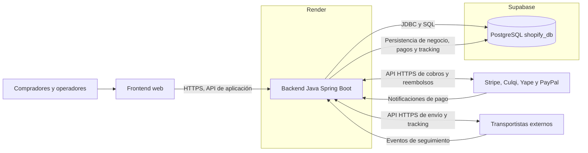

# Arquitectura de shopify_db

## Objetivo

Definir una arquitectura para un comercio electrónico tipo Shopify que centralice el catálogo, los clientes, el inventario, el carrito, los pedidos, los pagos, los descuentos y los envíos en PostgreSQL. La aplicación delega el cobro a pasarelas externas y el seguimiento logístico a transportistas, mientras conserva localmente el estado comercial y el historial necesario para operar y reconciliar.

El modelo físico documentado procede exclusivamente de [`database/01_esquema_shopify.sql`](../database/01_esquema_shopify.sql). Las responsabilidades de aplicación descritas aquí no presuponen tablas, vistas, funciones o servicios adicionales.

## Alcance

La arquitectura comprende:

- un frontend web para compradores y usuarios administrativos;
- un backend previsto en Java Spring Boot que concentra las reglas de negocio y el acceso a datos;
- una base PostgreSQL administrada en Supabase como único almacén persistente de la aplicación;
- integración HTTPS con Stripe, Culqi, Yape y PayPal como APIs externas de pago;
- integración con transportistas externos para obtener números y eventos de seguimiento;
- despliegue de los componentes de aplicación previstos en Render.

No se incluyen Redis, una segunda base de datos, un almacén de eventos independiente ni procesamiento de pagos o tracking dentro de PostgreSQL. El frontend y las credenciales concretas de proveedores quedan fuera del esquema SQL.

## Tecnologías

| Capa | Tecnología o enfoque | Responsabilidad |
| --- | --- | --- |
| Frontend | Aplicación web; el SQL no prescribe un framework | Presentación del catálogo, carrito, checkout y administración mediante la API del backend |
| Backend | Java Spring Boot, previsto | Reglas de negocio, autorización, transacciones, integraciones y persistencia |
| Base de datos | PostgreSQL administrado en Supabase | Datos relacionales, restricciones, índices y campos JSONB ya definidos en el esquema |
| Despliegue | Render | Ejecución y publicación de los servicios de aplicación |
| Pagos | APIs de Stripe, Culqi, Yape y PayPal | Autorización, confirmación y operaciones de cobro o reembolso fuera de la base |
| Logística | APIs de transportistas | Datos y eventos externos de seguimiento |

## Vista general

El frontend no accede directamente a Supabase ni a las credenciales de los proveedores. Toda escritura de negocio pasa por el backend, que valida la operación y utiliza las transacciones de PostgreSQL cuando una acción debe actualizar varias tablas de forma atómica.

## Responsabilidades por componente

### Frontend

Presenta productos y variantes, administra el carrito y el checkout, y ofrece las vistas de seguimiento y administración. Se comunica con el backend mediante HTTPS. No contiene secretos de pasarelas o transportistas ni establece una vía alternativa de escritura sobre la base de datos.

### Backend

Expone las operaciones de aplicación, comprueba identidad y permisos, calcula importes, coordina inventario y pedidos, y transforma las respuestas externas a los estados permitidos por el esquema. También registra los eventos de pago y envío. La base de datos garantiza las restricciones declaradas, pero la orquestación del checkout, las llamadas externas y la conciliación son responsabilidades del backend.

### Supabase y PostgreSQL

Supabase aloja el servicio PostgreSQL administrado. La base `shopify_db` conserva todas las entidades del dominio, incluidos los intentos de pago y el historial de tracking. Los campos `JSONB` de `pago_eventos` y `registros_auditoria` forman parte de PostgreSQL y no implican otra base. Las copias de seguridad, la disponibilidad del servicio y el mantenimiento del motor se apoyan en la administración de Supabase; la aplicación sigue siendo responsable de sus consultas, migraciones y controles de acceso.

### APIs externas

Las pasarelas procesan el dinero y los transportistas generan la información logística. Ninguno de estos proveedores se convierte en una base de datos interna. El backend almacena identificadores y referencias externas para relacionar respuestas con pedidos, pagos o envíos locales, y conserva los eventos recibidos en las tablas previstas.

## Justificación de una base única

Una sola base PostgreSQL evita sincronizar catálogos, pedidos, pagos y envíos entre almacenes con estados potencialmente divergentes. Las claves foráneas permiten mantener la integridad entre módulos y las transacciones facilitan operaciones coherentes, por ejemplo, completar un pedido y conservar sus líneas y descuentos.

Esta decisión también simplifica el despliegue y la operación: Render ejecuta la aplicación y Supabase concentra la persistencia. No se introduce Redis ni otra base para caché, sesiones, eventos o reporting; las sesiones, la auditoría y los eventos ya tienen tablas en el esquema. Si en el futuro se propusiera otro almacén, requeriría una decisión de arquitectura nueva y no debe darse por existente en esta línea base.

## Pasarelas de pago externas

`pasarelas_pago` es el catálogo local de proveedores, no una implementación de las pasarelas. `pagos` vincula un pedido con una pasarela y puede conservar `transaccion_externa_id`; `pago_eventos` guarda el historial, el `payload` y la `referencia_externa`; `reembolsos` relaciona la devolución con su pedido y pago.

El flujo previsto es:

1. El backend prepara la operación para un pedido y selecciona una pasarela activa.
2. La pasarela recibe la solicitud por su API y responde directamente o mediante una notificación posterior.
3. El backend autentica la comunicación, contrasta la referencia con el pago local y actualiza el estado conforme a las restricciones del esquema.
4. El backend inserta en `pago_eventos` los cambios y datos relevantes recibidos; las devoluciones se representan en `reembolsos` cuando corresponda.

Las claves privadas se configuran únicamente en el entorno seguro del backend. La recepción de una notificación no debe, por sí sola, cambiar importes o estados sin validar su autenticidad y correspondencia con la operación local.

## Tracking proporcionado por transportistas

`transportistas` mantiene el catálogo local de proveedores logísticos. Cada fila de `envios` pertenece a un pedido y puede indicar transportista, ubicación de origen, número de tracking y URL de seguimiento. Sus líneas se detallan en `envio_items`, vinculadas con los artículos del pedido.

Los transportistas producen el tracking fuera de la aplicación. El backend consulta o recibe esos eventos y los guarda en `envio_eventos` con el estado, la descripción, la ubicación, la fecha de ocurrencia y la referencia externa disponible. De este modo, la consulta del historial no depende de que el proveedor esté disponible en ese momento y no se requiere una base de tracking separada. El estado actual del envío y sus marcas de envío o entrega permanecen en `envios`; la secuencia histórica permanece en `envio_eventos`.

## Despliegue y evolución

Render aloja los servicios de aplicación y recibe la configuración de conexión y los secretos mediante variables de entorno. Supabase permanece como servicio administrado independiente. Los cambios estructurales deben partir del SQL fuente de verdad, probar sus restricciones y actualizar la documentación en la misma revisión. Las integraciones deben poder evolucionar sin agregar proveedores como componentes internos: se incorporan mediante configuración y adaptadores del backend, conservando en PostgreSQL únicamente los datos definidos por el esquema.
