# Modelo de datos de shopify_db

## Descripción

El modelo representa un comercio electrónico tipo Shopify multi-tienda, organizado en diez módulos: tiendas y tenants, usuarios y seguridad, catálogo, inventario, carrito y checkout, pedidos, pagos, envíos y tracking, descuentos, y reseñas y listas. La única fuente de verdad es [`database/01_esquema_shopify.sql`](../database/01_esquema_shopify.sql).

El esquema contiene **59 tablas**, **86 claves foráneas** y **71 índices creados explícitamente con `CREATE INDEX`** (V1 en `01_esquema_shopify.sql` + migraciones `V2–V19` en `database/migrations/`). El recuento de índices no incluye los índices implícitos que PostgreSQL pueda crear para restricciones de clave primaria o unicidad.

Los diagramas muestran solamente claves primarias, claves foráneas y campos relevantes. Las entidades de otros módulos se repiten cuando son necesarias para representar una FK real; no se dibujan relaciones para referencias meramente lógicas.

## Inventario completo de tablas

### Tiendas y tenants: 5 tablas

| Tabla | Propósito |
| --- | --- |
| `tiendas` | Tenants de la plataforma (V10). |
| `tienda_pasarelas` | Credenciales de pasarela por tienda, secretos cifrados (V10). |
| `tienda_usuarios` | Rol staff de un usuario dentro de una tienda: actual `admin`/`operador` (V12); objetivo B: `store_owner` (exactamente 1) / `admin` / `operador` (V21–V22). SUPER_ADMIN va en `usuario_roles` global. |
| `suscripciones` | Suscripción de la tienda al software, una por tienda (V18). |
| `suscripcion_eventos` | Eventos de facturación procesados, dedup por referencia (V18). |

### Usuarios y seguridad: 12 tablas

| Tabla | Propósito |
| --- | --- |
| `usuarios` | Identidades del ámbito administrativo (STORE_OWNER/ADMIN/OPERATOR/SUPER_ADMIN): credenciales, estado y 2FA TOTP (V2). Objetivo B: dejan de crear perfil comprador al registrarse. |
| `roles` | Catálogo de roles. Objetivo B: solo `super_admin` global; el rol `cliente` sale de `usuario_roles`. |
| `permisos` | Catálogo de permisos asociables a roles. |
| `rol_permisos` | Asociación entre roles y permisos, única para cada pareja. |
| `usuario_roles` | Asociación entre usuarios y roles, única para cada pareja. |
| `clientes` | Perfil CUSTOMER por tienda. Actual: vínculo 1:1 global con `usuarios` (V5). Objetivo B: `email` UNIQUE por tienda (V20), `usuario_id` nullable transitorio (V20) y eliminado (V23); sesiones propias en `cliente_sesiones` + códigos en `cliente_codigos` (V21). |
| `direcciones` | Direcciones postales de CUSTOMERs. |
| `sesiones` | Sesiones staff con refresh rotado (V8). Objetivo B: CUSTOMER usa `cliente_sesiones` (V21). |
| `usuario_codigos_recuperacion` | Códigos de recuperación 2FA (hash, un solo uso). Añadida en V2. |
| `tokens_cuenta` | Tokens de verificación email / reset password (hash, un solo uso). Añadida en V15. |
| `notificaciones` | Avisos de la bandeja staff por tienda. Añadida en V16. |
| `registros_auditoria` | Historial de acciones, con usuario opcional y referencia lógica a la entidad afectada. |

### Catálogo: 12 tablas

| Tabla | Propósito |
| --- | --- |
| `proveedores` | Proveedores opcionalmente asociados a productos. |
| `productos` | Información general y estado de publicación de los productos. |
| `producto_opciones` | Opciones configurables de un producto, como sus dimensiones de variación. |
| `producto_opcion_valores` | Valores posibles de cada opción de producto. |
| `producto_variantes` | Versiones comprables con SKU, precio, peso y estado. |
| `variante_opcion_valores` | Combinación de valores de opción que identifica cada variante. |
| `producto_imagenes` | Imágenes de producto con asociación opcional a una variante. |
| `colecciones` | Agrupaciones editoriales de productos. |
| `coleccion_productos` | Asociación ordenada entre colecciones y productos. |
| `etiquetas` | Catálogo de etiquetas reutilizables. |
| `producto_etiquetas` | Asociación entre productos y etiquetas. |
| `metacampos` | Datos extensibles por clave mediante una referencia lógica a una entidad. |

### Inventario: 4 tablas

| Tabla | Propósito |
| --- | --- |
| `ubicaciones` | Lugares físicos o lógicos desde los que se controla stock. |
| `articulos_inventario` | Configuración de inventario y envío asociada a variantes. |
| `niveles_inventario` | Cantidades disponibles y reservadas por artículo y ubicación. |
| `movimientos_inventario` | Entradas, salidas, ajustes, reservas y liberaciones de un nivel de inventario. |

### Carrito y checkout: 6 tablas

| Tabla | Propósito |
| --- | --- |
| `carritos` | Carritos identificados por token, con cliente opcional, moneda, estado y vencimiento. |
| `carrito_items` | Variantes, cantidades y precios unitarios incluidos en un carrito. |
| `metodos_envio` | Catálogo de métodos de envío seleccionables durante el checkout. |
| `tasas_impuesto` | Configuración independiente de tasas por ámbito geográfico. |
| `checkout_sesiones` | Datos e importes de un intento de checkout asociado a un carrito. |
| `checkout_descuentos` | Descuentos aplicados a un checkout y monto calculado (V19). |

### Pedidos: 5 tablas

| Tabla | Propósito |
| --- | --- |
| `pedidos` | Cabecera del pedido, importes, moneda, estado, cliente obligatorio (V5) y archivado lógico (V4). |
| `pedido_impuestos` | Snapshot de impuestos por pedido/línea: título, tasa y monto (V9). |
| `pedido_items` | Líneas de venta con copia histórica de título, SKU, cantidad y precios. |
| `pedido_direcciones` | Copia de las direcciones de envío o facturación del pedido. |
| `historial_estados_pedido` | Cambios de estado del pedido con comentario y usuario opcional. |

### Pagos: 4 tablas

| Tabla | Propósito |
| --- | --- |
| `pasarelas_pago` | Catálogo local de proveedores de pago, como Stripe, Culqi, Yape o PayPal. |
| `pagos` | Pagos o intentos de pago de un pedido y su referencia externa. |
| `pago_eventos` | Historial de eventos y cambios de estado de un pago, con payload y referencia externa. |
| `reembolsos` | Solicitudes o resultados de reembolso vinculados a un pedido y un pago. |

### Envíos y tracking: 4 tablas

| Tabla | Propósito |
| --- | --- |
| `transportistas` | Catálogo de proveedores logísticos y sus datos generales de tracking. |
| `envios` | Envíos de pedidos con transportista, origen, tracking y estado. |
| `envio_items` | Cantidades de artículos del pedido incluidas en cada envío. |
| `envio_eventos` | Eventos de seguimiento proporcionados por el transportista. |

### Descuentos: 4 tablas

| Tabla | Propósito |
| --- | --- |
| `descuentos` | Reglas, vigencia, activación y contadores de uso de descuentos. |
| `pedido_descuentos` | Descuentos aplicados a pedidos y monto efectivamente aplicado. |
| `descuento_productos` | Productos incluidos en el alcance de un descuento. |
| `descuento_colecciones` | Colecciones incluidas en el alcance de un descuento. |

### Reseñas y listas: 3 tablas

| Tabla | Propósito |
| --- | --- |
| `resenas` | Valoraciones de productos con cliente opcional y estado de aprobación. |
| `listas_deseos` | Listas de productos deseados pertenecientes a clientes. |
| `lista_deseo_items` | Productos incluidos en una lista de deseos. |

## Relaciones y cardinalidad

### Relaciones 1:N

Una FK en una tabla hija representa normalmente una relación uno a muchos: una fila padre puede aparecer en varias filas hijas y cada hija apunta a un padre. Por ejemplo:

- `usuarios` 1:N `sesiones` mediante `sesiones.usuario_id`.
- `clientes` 1:N `direcciones` mediante `direcciones.cliente_id`.
- `productos` 1:N `producto_variantes` mediante `producto_variantes.producto_id`.
- `carritos` 1:N `carrito_items` mediante `carrito_items.carrito_id`.
- `pedidos` 1:N `pedido_items`, `pagos`, `envios` y `pedido_direcciones`.
- `envios` 1:N `envio_eventos` mediante `envio_eventos.envio_id`.

Cuando la FK es nullable, la relación es opcional para la fila hija. Así ocurre, entre otros, con `carritos.cliente_id`, `pedido_items.variante_id`, `envios.transportista_id` y `resenas.cliente_id`. La unicidad y nulidad de `clientes.usuario_id` (NOT NULL desde V5) limitan esa relación a uno a uno estricto; la unicidad de `pedidos.checkout_sesion_id` hace lo propio entre un pedido y su sesión de checkout.

### Relaciones N:M

Las tablas asociativas contienen dos FK y resuelven relaciones muchos a muchos. Algunas añaden orden, cantidades o importes:

- `rol_permisos`: roles con permisos.
- `usuario_roles`: usuarios con roles.
- `variante_opcion_valores`: variantes con valores de opción.
- `coleccion_productos`: colecciones con productos.
- `producto_etiquetas`: productos con etiquetas.
- `niveles_inventario`: artículos de inventario con ubicaciones, además de sus cantidades.
- `carrito_items`: carritos con variantes, además de cantidad y precio.
- `pedido_descuentos`: pedidos con descuentos y monto aplicado.
- `checkout_descuentos`: checkouts con descuentos y monto calculado (V19).
- `descuento_productos`: descuentos con productos.
- `descuento_colecciones`: descuentos con colecciones.
- `lista_deseo_items`: listas de deseos con productos.

Las restricciones `UNIQUE` declaradas impiden duplicar determinadas parejas (`uq_pedido_descuento`, `uq_checkout_descuento` (V19)). No se presupone esa unicidad donde el SQL no la declara.

### Referencias lógicas polimórficas

Dos tablas utilizan `entidad` y `entidad_id` para aludir a distintos tipos de registro:

- **`metacampos`** no tiene ninguna FK. La pareja `entidad`, `entidad_id` es una referencia lógica que la aplicación debe interpretar y validar. Su restricción única incluye también `clave`, pero no establece integridad referencial con la entidad citada.
- **`registros_auditoria`** tiene como única FK `usuario_id`, que referencia a `usuarios`. Sus campos `entidad` y `entidad_id` forman una referencia lógica a la entidad auditada; `entidad_id` no es una FK.

Por ello, los diagramas no conectan estos campos con tablas concretas. Borrar o modificar una fila referenciada lógicamente no produce una acción referencial automática en PostgreSQL.

### Tablas de configuración sin FK salientes

`tasas_impuesto` es independiente: no declara FK y ninguna otra tabla del esquema la referencia. Los importes de impuestos guardados en checkout y pedidos no crean una relación física con esta tabla.

`metodos_envio` tampoco declara FK salientes, pero no está aislada: `checkout_sesiones.metodo_envio_id` la referencia. Otras tablas catálogo, como `roles`, `permisos` o `transportistas`, siguen el mismo patrón de no tener FK salientes y recibir referencias desde otras tablas.

## Diagrama ER general simplificado

Este diagrama resume el recorrido principal desde catálogo y carrito hasta pedido, pago y envío. Los diez diagramas posteriores distribuyen las 84 FK sin omitir las relaciones de módulos no incluidos aquí.

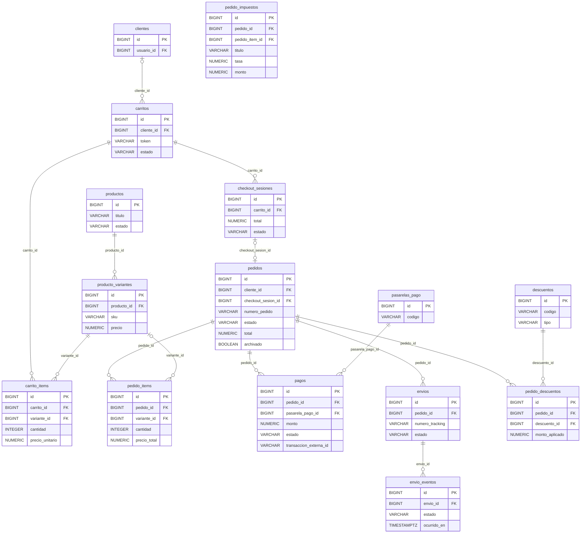

## Diagramas por módulo

### Tiendas y tenants

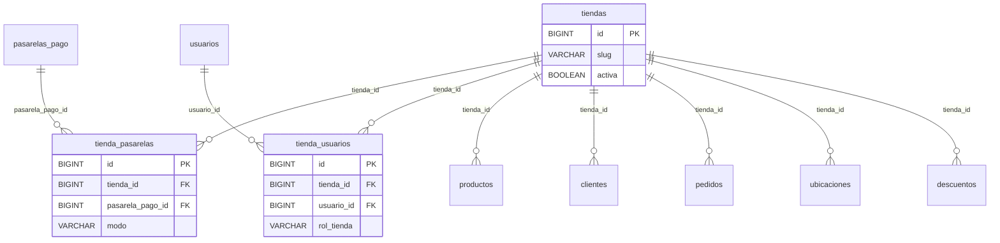

Nueve raíces llevan `tienda_id` propio (productos, clientes, pedidos, ubicaciones, descuentos, carritos, checkout_sesiones, metodos_envio, tasas_impuesto); el resto lo hereda por join. Todo `ON DELETE RESTRICT` hacia tiendas: la baja es desactivar.

### Usuarios y seguridad

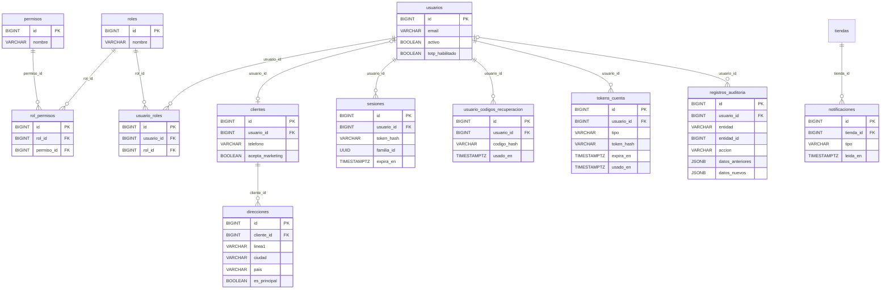

`registros_auditoria.entidad_id` aparece deliberadamente sin marca FK: solo `usuario_id` tiene integridad referencial declarativa.

### Catálogo

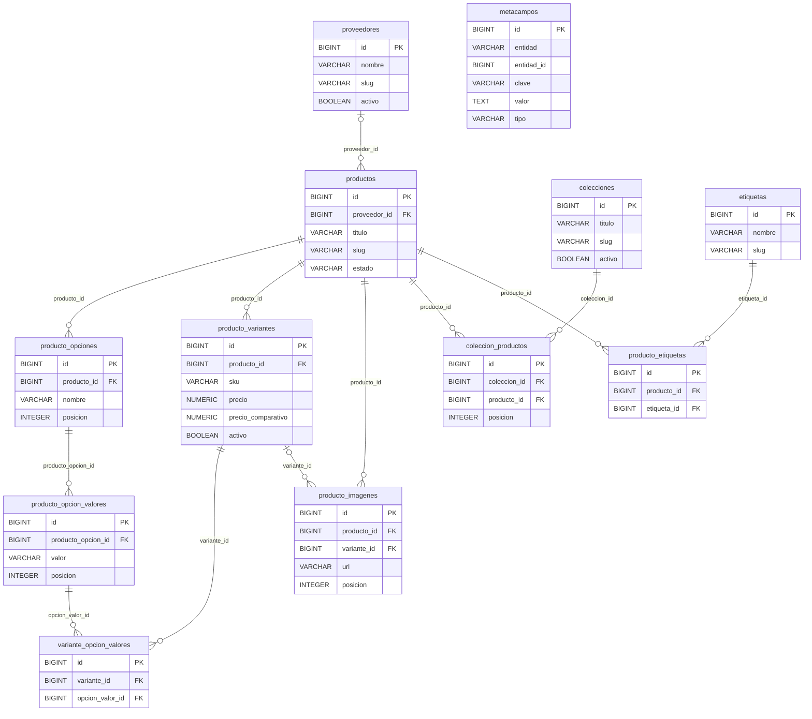

`metacampos` permanece sin conectores porque no declara FK. Su relación con cualquier entidad es lógica y polimórfica.

### Inventario

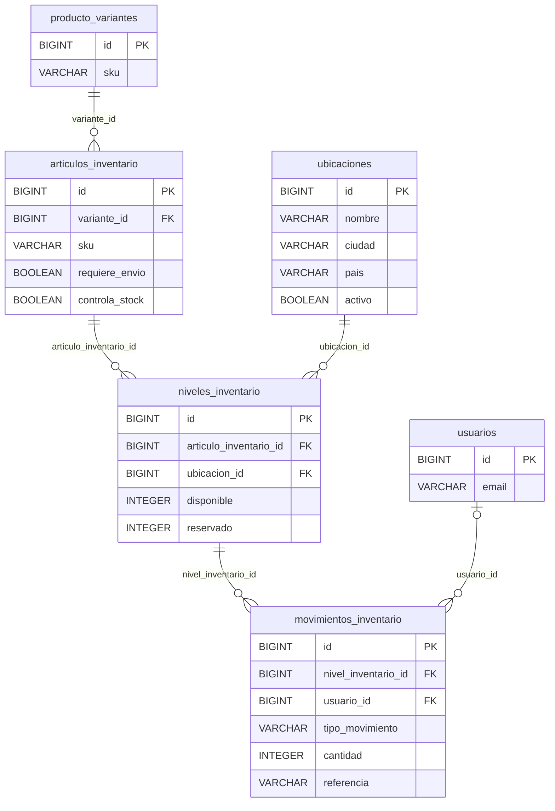

La pareja `articulo_inventario_id`, `ubicacion_id` es única en `niveles_inventario`. Los movimientos pertenecen a un nivel concreto y conservan opcionalmente el usuario que los originó.

### Carrito y checkout

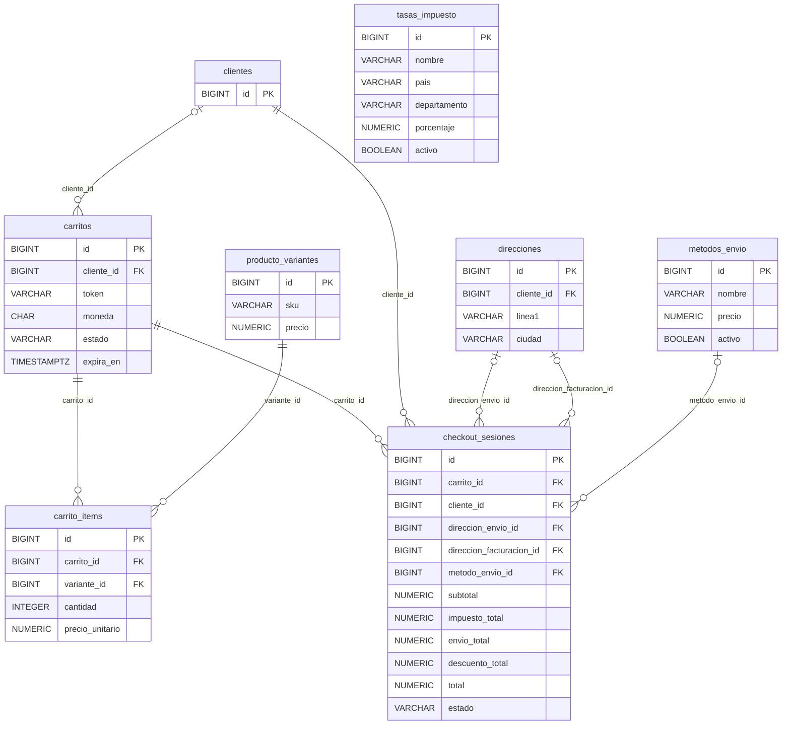

Las dos relaciones entre `direcciones` y `checkout_sesiones` corresponden a FK distintas. `tasas_impuesto` no tiene conectores porque el SQL no declara ninguna relación física para esa tabla.

### Pedidos

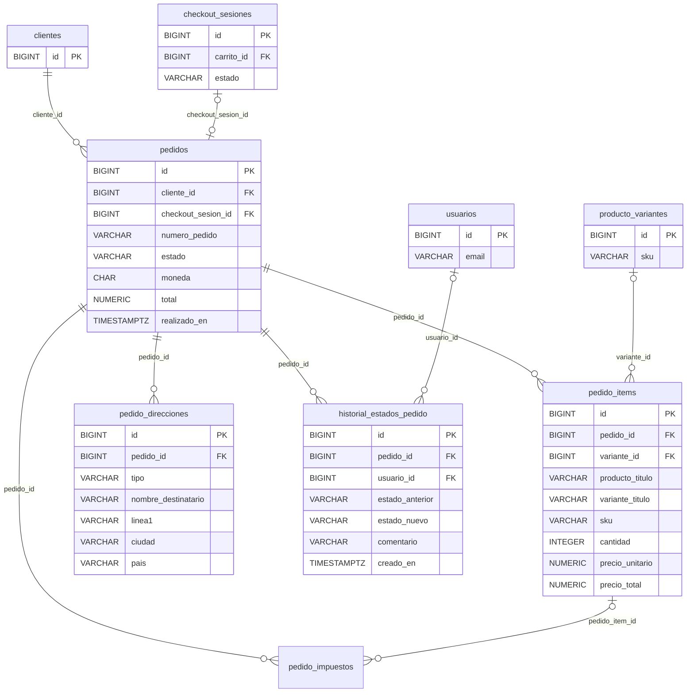

`pedido_items` guarda datos históricos del producto y de la variante; si se elimina la variante, su FK puede quedar nula sin perder la línea. `pedido_direcciones` conserva una copia propia y no referencia a `direcciones`.

### Pagos

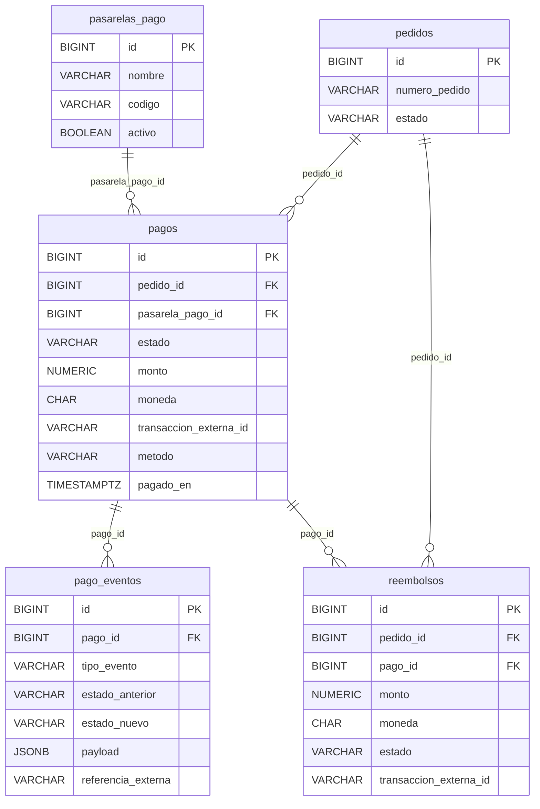

La pasarela de un pago se protege con `ON DELETE RESTRICT`. Los eventos dependen del pago y los reembolsos exigen tanto pedido como pago; no existe una FK directa desde `pago_eventos` hacia una API o proveedor externo.

### Envíos y tracking

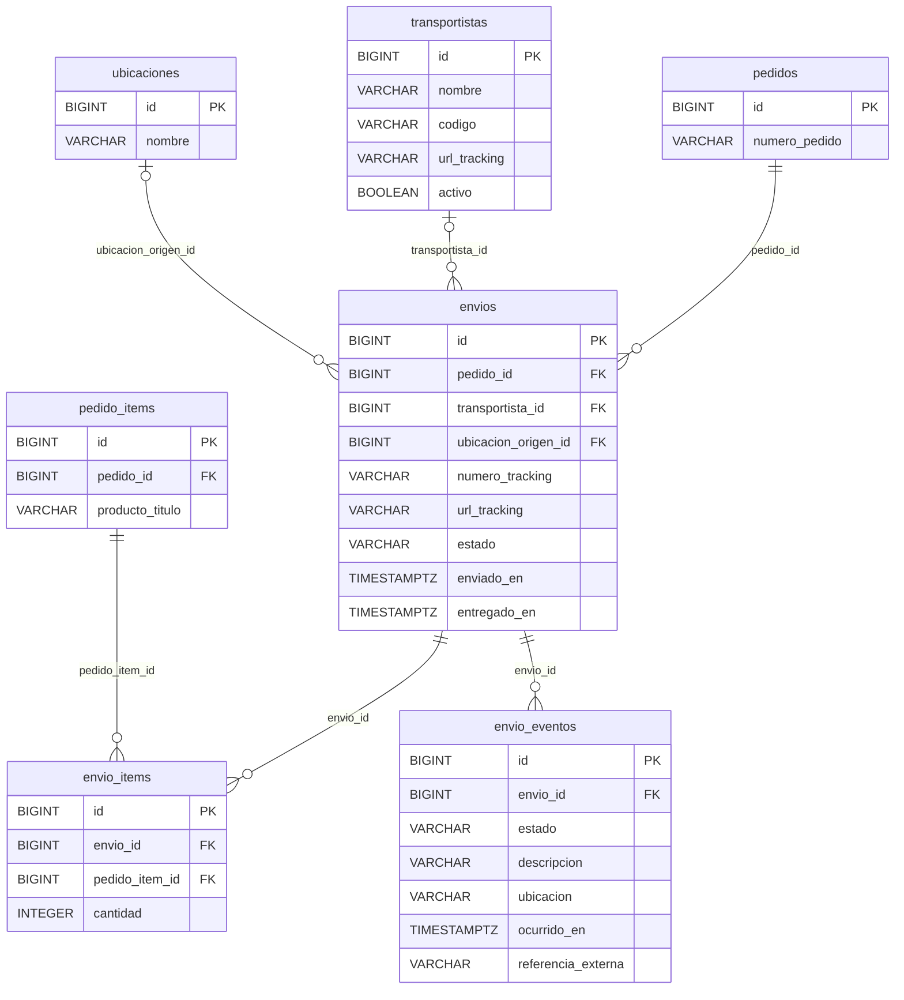

Los eventos de `envio_eventos` proceden del tracking externo del transportista, pero su única FK es `envio_id`. `transportista` en `envios` es un campo de texto y no una segunda FK; la relación estructurada es `transportista_id`.

### Descuentos

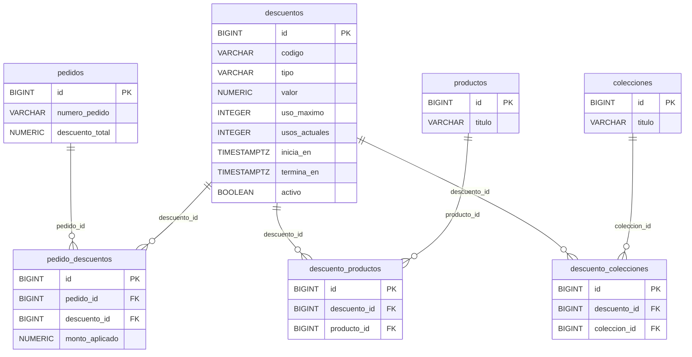

Las asociaciones de alcance con productos y colecciones tienen unicidad por pareja. `pedido_descuentos.descuento_id` usa `ON DELETE RESTRICT`, de modo que un descuento aplicado no puede eliminarse mientras exista esa referencia.

### Reseñas y listas

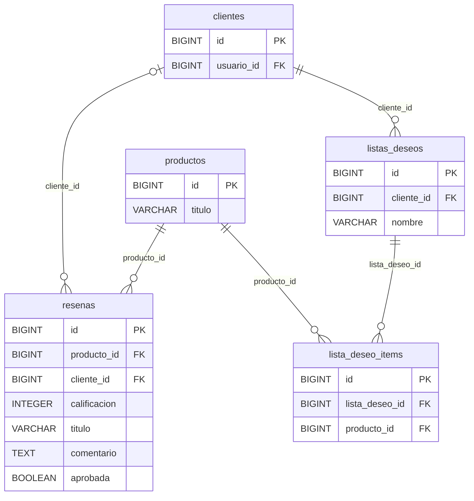

La calificación de una reseña está limitada por el esquema a valores entre 1 y 5. Cada producto puede aparecer una sola vez en una lista concreta debido a la restricción única de `lista_deseo_items`.

## Integridad y conservación histórica

El esquema combina borrados en cascada con conservación de cabeceras históricas. Las líneas dependientes se eliminan en cascada cuando desaparece su agregado, mientras que varias referencias comerciales opcionales usan `ON DELETE SET NULL`. En particular, `pedido_items` y `pedido_direcciones` conservan valores propios para que el pedido no dependa por completo de los datos actuales del catálogo o de la libreta de direcciones.

Las acciones `ON DELETE` representadas en esta descripción proceden del SQL más las migraciones V2–V19; no se añaden disparadores ni reglas automáticas no declaradas salvo los triggers de `actualizado_en` (V7). La aplicación debe mantener las invariantes que una FK no puede expresar, como la correspondencia de un reembolso con un pago perteneciente al mismo pedido o la validez de las referencias lógicas polimórficas.
