# Flujos principales

Los diagramas describen orquestación de Spring Boot sobre PostgreSQL/Supabase y servicios externos. Las escrituras agrupadas como transacción son locales a la base de datos; una llamada a una API externa no participa en esa transacción y requiere confirmación, reintentos controlados y conciliación. Los estados usados para columnas con `CHECK` son exclusivamente los declarados en `database/01_esquema_shopify.sql`.

## Flujo 1: Registro e inicio de sesión staff (actual pre-B; CUSTOMER en RF-AUTH-10)

### Objetivo

Crear la identidad staff y, posteriormente, autenticar al usuario y establecer una sesión con sus roles y permisos. Objetivo B: el registro staff no crea perfil CUSTOMER (RF-AUTH-09); CUSTOMER usa passwordless (RF-AUTH-10).

### Actores

Visitante, usuario registrado, backend Spring Boot y PostgreSQL/Supabase.

### Tablas involucradas

`usuarios`, `clientes`, `roles`, `permisos`, `usuario_roles`, `rol_permisos`, `sesiones` y `usuario_codigos_recuperacion`.

### Mermaid

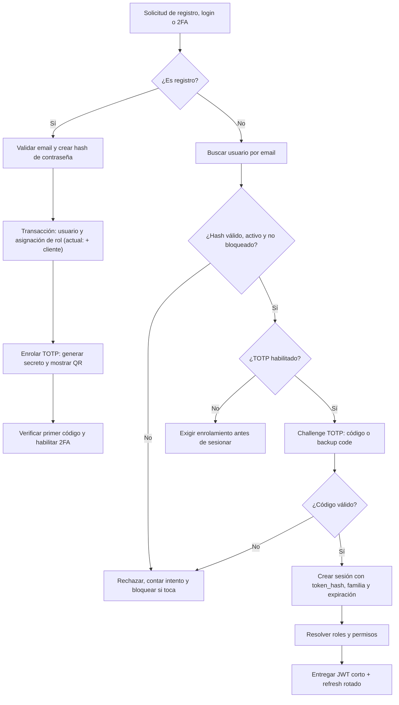

### Pasos

1. En el registro, el backend normaliza el email y verifica su formato y los requisitos de contraseña antes de generar `password_hash` con Argon2id o BCrypt; nunca guarda la contraseña en texto plano.
2. En una transacción inserta `usuarios` (con `email_verificado = FALSE` y `totp_habilitado = FALSE`) y añade en `usuario_roles` el rol inicial autorizado (actual pre-B: además crea el `clientes` asociado; objetivo B: el registro staff no crea CUSTOMER). La unicidad de `usuarios.email` se aplica en la base; cualquier fallo revierte las operaciones.
3. En el enrolamiento TOTP genera el secreto, lo guarda cifrado y muestra el QR (`otpauth://`). Al verificar el primer código, en la misma transacción pone `totp_habilitado = TRUE`, `totp_confirmado_en` y genera los backup codes con hash en `usuario_codigos_recuperacion`. Sin enrolar no se crea sesión.
4. En el login, busca el usuario por email, compara la contraseña con `password_hash` y exige `usuarios.activo = TRUE` y `bloqueado_hasta` pasado. Una respuesta genérica evita revelar si el email existe. Cada fallo suma `intentos_fallidos` y bloquea tras el umbral (p. ej. 5 intentos, 15 minutos).
5. Con password válido y TOTP habilitado, exige el challenge: código TOTP (ventana ±1 paso) o backup code (marca `usado_en`). Si es válido, resetea `intentos_fallidos` y actualiza `ultimo_acceso`.
6. Si la autenticación completa es válida, inserta `sesiones` con `token_hash` (SHA-256 del refresh opaco), `familia_id` nueva y `expira_en`, más `ip` y `user_agent` cuando estén disponibles. Entrega JWT de acceso corto (15 min) y refresh rotado según V8: reutilizar un refresh ya rotado revoca la familia entera.
7. Resuelve los roles mediante `usuario_roles` y `roles`, y los permisos mediante `rol_permisos` y `permisos`. Spring Security aplica esa autorización en cada solicitud; las tablas por sí solas no protegen endpoints.
8. En solicitudes posteriores, valida JWT o refresh por hash, vigencia y no revocación. El esquema no contempla passwords en texto plano ni tokens sin hash desde V8.

### Posibles estados finales

- Registro completado con `usuarios.activo = TRUE` y rol asociado (actual pre-B: + CUSTOMER asociado), pero sin sesión hasta enrolar TOTP.
- Enrolamiento completado con 2FA habilitado y backup codes emitidos.
- Autenticación completada con sesión vigente (`token_hash` + familia), JWT corto y roles resueltos.
- Registro, login o challenge rechazado o bloqueado sin cambios parciales; un usuario inactivo o bloqueado no obtiene sesión.

## Flujo 2: Creación de producto con variantes

### Objetivo

Configurar un producto, sus opciones y valores, y generar variantes comprables sin combinaciones incoherentes o duplicadas.

### Actores

STORE_OWNER, ADMIN u OPERATOR autorizado, backend Spring Boot y PostgreSQL/Supabase.

### Tablas involucradas

`productos`, `producto_opciones`, `producto_opcion_valores`, `producto_variantes`, `variante_opcion_valores` y, cuando se inicializa su control logístico, `articulos_inventario`.

### Mermaid

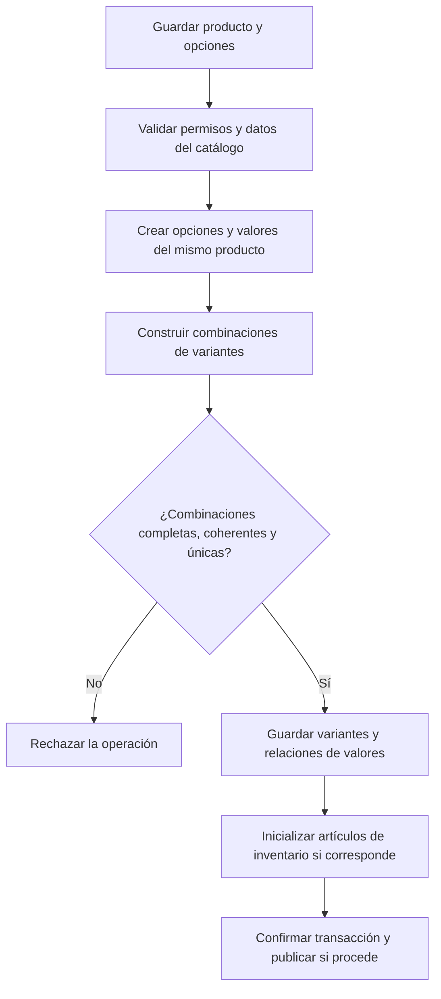

### Pasos

1. El backend comprueba el permiso administrativo y crea o actualiza `productos` con estado inicial `borrador`, salvo que una operación autorizada indique otro estado permitido.
2. Registra las opciones y sus valores mediante `producto_opciones` y `producto_opcion_valores`, respetando las posiciones definidas para presentación.
3. Para cada variante valida precio y demás datos, genera `producto_variantes` y asocia valores en `variante_opcion_valores`.
4. Antes de confirmar, la aplicación verifica que todos los valores pertenezcan al producto, que haya como máximo un valor por opción, que la combinación esté completa y que ninguna otra variante activa tenga la misma combinación. Las claves foráneas y `uq_variante_opcion_valor` no realizan esas cuatro validaciones de negocio.
5. Crea `articulos_inventario` cuando la variante requiera control logístico. Si se adopta una sola ficha por variante, la aplicación lo comprueba porque el esquema no declara única esa columna.
6. Confirma todo en una transacción. La publicación cambia el producto a `activo` y solo deja comprables las variantes con `activo = TRUE`; un producto puede permanecer en `borrador` o pasar a `archivado` según la operación.

### Posibles estados finales

- `productos.estado = 'borrador'` con la configuración guardada pero sin publicación.
- `productos.estado = 'activo'` con variantes activas y combinaciones validadas por la aplicación.
- `productos.estado = 'archivado'` si la operación era de archivo.
- Operación rechazada sin producto, opciones o relaciones parciales.

## Flujo 3: Agregar producto al carrito

### Objetivo

Crear o recuperar el carrito de un CUSTOMER o visitante y añadir una cantidad válida de una variante comprable.

### Actores

CUSTOMER autenticado o visitante, backend Spring Boot y PostgreSQL/Supabase.

### Tablas involucradas

`carritos`, `carrito_items`, `clientes`, `productos`, `producto_variantes`, `articulos_inventario` y `niveles_inventario`.

### Mermaid

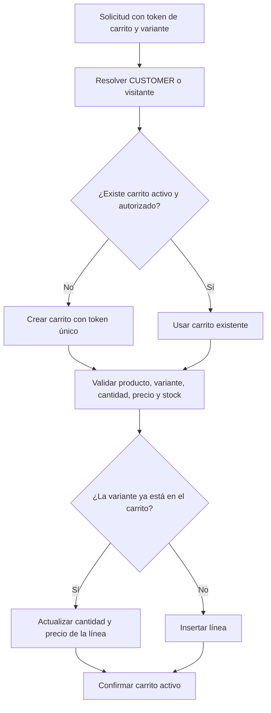

### Pasos

1. El backend identifica al CUSTOMER por su sesión o al visitante por el token del carrito. Para un visitante, `carritos.cliente_id` permanece nulo; `token` es obligatorio en ambos casos.
2. Recupera un carrito `activo` y no expirado, verificando token y titularidad. Si no existe, crea uno con moneda y, cuando corresponda, `expira_en`.
3. Valida que el producto esté `activo`, la variante tenga `activo = TRUE` y la cantidad solicitada sea positiva. Consulta el precio vigente y, si `controla_stock = TRUE`, comprueba disponibilidad en las ubicaciones aplicables sin asumir que agregar al carrito ya reserva stock.
4. Inserta `carrito_items` con el precio unitario calculado. Si la variante ya existe, la aplicación actualiza esa línea y su cantidad de forma atómica, apoyándose en `uq_carrito_variante` para impedir duplicados.
5. Actualiza `carritos.actualizado_en` desde la aplicación; no existe trigger que lo haga. Los cambios de línea y del carrito se confirman juntos.

### Posibles estados finales

- `carritos.estado = 'activo'` con una línea nueva o actualizada.
- `carritos.estado = 'activo'` sin cambios si la variante, cantidad, autorización o disponibilidad no es válida.
- `carritos.estado = 'expirado'` si la aplicación cierra un carrito cuya vigencia terminó; no se agrega la línea a ese carrito.

## Flujo 4: Proceso de checkout

### Objetivo

Preparar una sesión de compra con direcciones, envío, impuestos, descuentos y totales recalculados antes de crear el pedido.

### Actores

CUSTOMER autenticado, backend Spring Boot y PostgreSQL/Supabase. (Actual pre-B: el checkout exige CUSTOMER con 2FA; objetivo B: CUSTOMER verificado por código.)

### Tablas involucradas

`carritos`, `carrito_items`, `checkout_sesiones`, `clientes`, `direcciones`, `metodos_envio`, `tasas_impuesto`, `productos`, `producto_variantes`, `articulos_inventario` y `niveles_inventario`.

### Mermaid

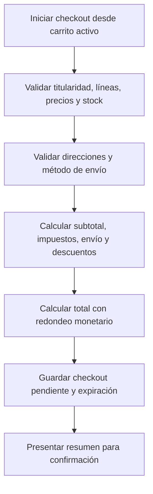

### Pasos

1. El backend valida que el carrito esté `activo`, no haya expirado, tenga líneas y sea accesible para el CUSTOMER autenticado.
2. Vuelve a consultar variantes, precios y stock. No confía en los importes enviados por el navegador ni en el precio histórico de `carrito_items`.
3. Verifica que las direcciones seleccionadas pertenezcan al CUSTOMER cuando corresponda y que el método de envío esté activo. Las claves foráneas de `checkout_sesiones` no comprueban esa titularidad.
4. Calcula `subtotal`, `impuesto_total`, `envio_total`, `descuento_total` y `total` con precisión y redondeo coherentes. La aplicación determina las tasas y descuentos válidos; la base solo exige importes no negativos.
5. Inserta o actualiza la sesión elegida en `checkout_sesiones` con estado `pendiente`, moneda y `expira_en`. Como `carrito_id` no es único, el backend evita operar simultáneamente con sesiones ambiguas del mismo carrito.
6. Presenta el resumen. No se crea todavía un pedido ni se marca el carrito como convertido.

### Posibles estados finales

- `checkout_sesiones.estado = 'pendiente'` con totales listos para confirmar.
- `checkout_sesiones.estado = 'pendiente'` sin cambios o sin nueva sesión si alguna validación falla.
- `checkout_sesiones.estado = 'expirado'` al vencer la vigencia, o `cancelado` si el actor cancela expresamente el checkout.
- El carrito permanece `activo` mientras no se complete la conversión.

## Flujo 5: Creación de pedido

### Objetivo

Convertir atómicamente un checkout válido en un pedido con líneas, direcciones y descuentos históricos, evitando conversiones duplicadas.

### Actores

CUSTOMER autenticado, backend Spring Boot y PostgreSQL/Supabase.

### Tablas involucradas

`checkout_sesiones`, `carritos`, `carrito_items`, `pedidos`, `pedido_items`, `pedido_direcciones`, `historial_estados_pedido`, `pedido_descuentos`, `descuentos`, `niveles_inventario` y `movimientos_inventario`.

### Mermaid

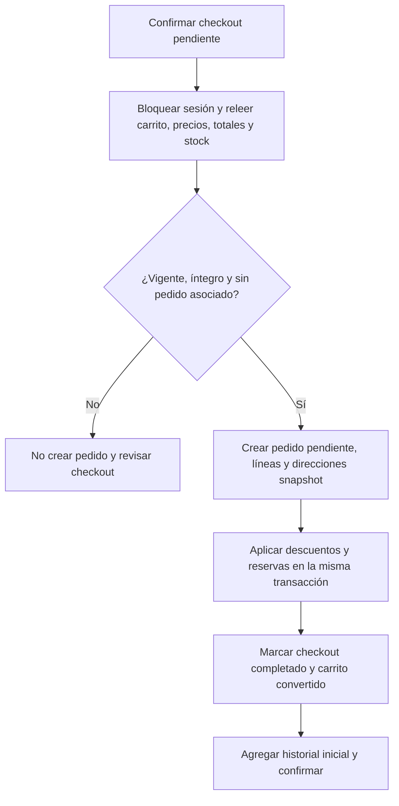

### Pasos

1. En una transacción, el backend bloquea la `checkout_sesiones` y verifica estado `pendiente`, vigencia, titularidad y ausencia de un pedido con ese `checkout_sesion_id`. La unicidad de la columna es una última barrera, no un sustituto del control de concurrencia.
2. Relee líneas, catálogo, stock, direcciones, envío, impuestos y descuentos, y recalcula los totales. Si algo cambió, no confirma una compra con datos obsoletos.
3. Genera un `numero_pedido` único e inserta `pedidos` con estado `pendiente`, importes confirmados y `realizado_en` según el instante de la operación.
4. Copia cada línea a `pedido_items`, incluyendo `producto_titulo`, `variante_titulo`, `sku`, cantidad, precio unitario y precio total. Copia las direcciones a `pedido_direcciones` usando únicamente los tipos `envio` y `facturacion`.
5. Persiste en `pedido_descuentos` los descuentos efectivamente aplicados y consume sus usos conforme al flujo de descuentos. Si la política reserva al crear el pedido, actualiza `niveles_inventario` e inserta movimientos `reserva` de forma atómica.
6. Marca `checkout_sesiones.estado = 'completado'`, `carritos.estado = 'convertido'` y agrega `historial_estados_pedido` con estado nuevo `pendiente`. La aplicación escribe todos estos cambios; no hay triggers de conversión.
7. Confirma la transacción. Si cualquier escritura falla, se revierten pedido, líneas, reservas, contadores y cambios de carrito y checkout.

### Posibles estados finales

- Conversión exitosa: `pedidos.estado = 'pendiente'`, `checkout_sesiones.estado = 'completado'` y `carritos.estado = 'convertido'`.
- Validación fallida sin pedido nuevo: el checkout permanece `pendiente` si sigue siendo utilizable y el carrito permanece `activo`.
- Checkout vencido o anulado: `checkout_sesiones.estado = 'expirado'` o `cancelado`, respectivamente, sin conversión parcial.

## Flujo 6: Pago con pasarela externa

### Objetivo

Iniciar un intento de pago por una pasarela activa, conservar su referencia y reflejar únicamente resultados confirmados.

### Actores

Cliente o visitante, backend Spring Boot, API externa de la pasarela y PostgreSQL/Supabase.

### Tablas involucradas

`pedidos`, `pasarelas_pago`, `pagos`, `pago_eventos` e `historial_estados_pedido`.

### Mermaid

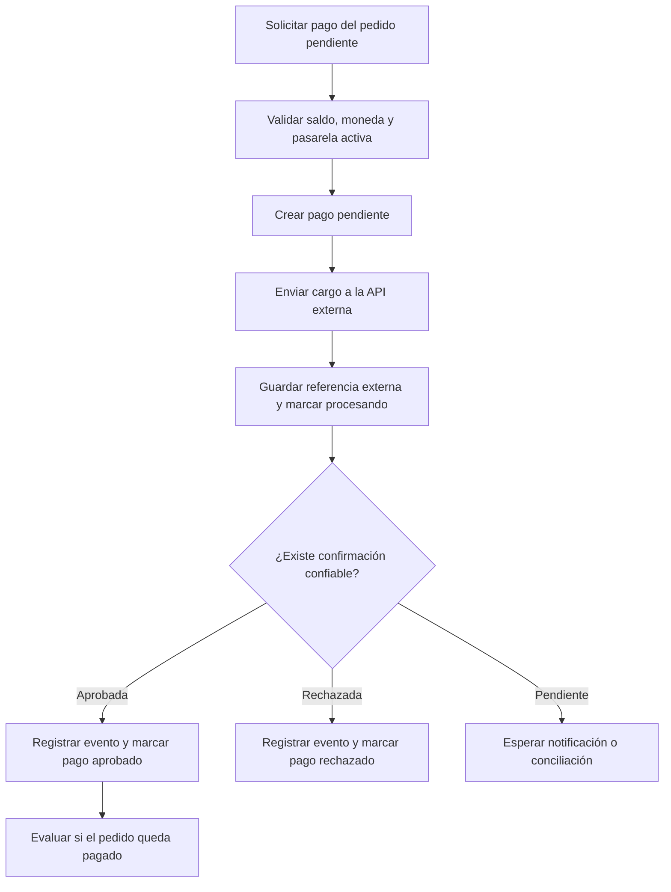

### Pasos

1. El backend verifica que el pedido esté `pendiente`, que la pasarela esté activa y que monto, moneda y saldo sean coherentes. La existencia de otros pagos no impide otro intento; la aplicación evita sobrepagos y cargos concurrentes innecesarios.
2. Inserta `pagos` con estado `pendiente` y la `pasarela_pago_id` seleccionada. No crea una orden de pago en otra tabla porque el esquema no la define.
3. Invoca la API externa con las credenciales mantenidas fuera de la base y del código. Al obtener respuesta, guarda `transaccion_externa_id` si fue entregado y cambia el pago a `procesando` cuando la operación quede en curso.
4. Registra en `pago_eventos` los cambios relevantes. Sus campos de estado no tienen `CHECK`, por lo que el backend usa los mismos estados válidos de `pagos` al historizarlos.
5. Solo una respuesta auténtica y suficiente permite marcar `aprobado` y completar `pagado_en`; un rechazo definitivo se registra como `rechazado`. Una cancelación real se registra como `cancelado`.
6. Si la suma de pagos aprobados cubre el total según la política, otra transacción local cambia el pedido a `pagado` y escribe su historial. Si la confirmación es asíncrona, el pedido permanece `pendiente` hasta el evento correspondiente.

### Posibles estados finales

- `pagos.estado = 'procesando'` o `pendiente` mientras se espera confirmación; el pedido permanece `pendiente`.
- `pagos.estado = 'aprobado'`; el pedido pasa a `pagado` solo si la aplicación confirma cobertura total.
- `pagos.estado = 'rechazado'` o `cancelado`; el pedido permanece `pendiente` salvo una cancelación independiente permitida por el negocio.

## Flujo 7: Registro de webhook o evento de pago

### Objetivo

Procesar una notificación externa de pago de forma autenticada, idempotente y consistente con el estado actual del pedido.

### Actores

API externa de la pasarela, backend Spring Boot y PostgreSQL/Supabase.

### Tablas involucradas

`pagos`, `pago_eventos`, `pedidos` e `historial_estados_pedido`.

### Mermaid

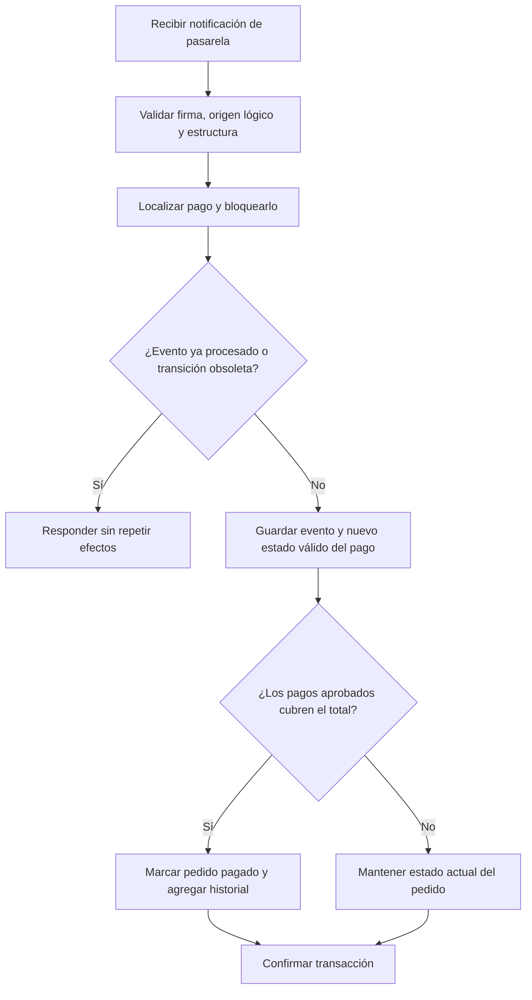

### Pasos

1. El endpoint valida la firma o el mecanismo de autenticación de la pasarela antes de confiar en el payload. Esta es una validación de aplicación, no una característica del esquema.
2. Localiza el pago por la referencia externa y los datos de la pasarela. Como `transaccion_externa_id` y `pago_eventos.referencia_externa` no son únicos, una referencia ausente o ambigua se deriva a revisión sin actualizar estados.
3. En una transacción bloquea el pago y comprueba referencia ya registrada, tipo de evento y transición. El bloqueo y la comprobación evitan repetir efectos entre notificaciones concurrentes del mismo pago; `pago_eventos` actúa como historial, no como una inbox con deduplicación automática.
4. Inserta el evento con `payload`, `referencia_externa`, `estado_anterior` y `estado_nuevo`. Actualiza `pagos.estado` únicamente a `pendiente`, `procesando`, `aprobado`, `rechazado`, `cancelado` o `reembolsado`, según corresponda al evento real.
5. Si el pago queda aprobado, calcula la cobertura total con los demás pagos aprobados. Cuando proceda, actualiza el pedido de `pendiente` a `pagado` y añade el historial en la misma transacción.
6. Responde a la pasarela después de confirmar. Para errores temporales se aplican reintentos de la integración; la idempotencia evita que esos reintentos repitan cambios funcionales.

### Posibles estados finales

- Evento nuevo aplicado: pago `aprobado`, `rechazado`, `cancelado`, `procesando` u otro estado permitido que refleje la notificación.
- Cobertura completa: `pedidos.estado = 'pagado'` con historial; cobertura incompleta o pago no aprobado: el pedido conserva un estado válido, normalmente `pendiente`.
- Evento duplicado, obsoleto o no auténtico: sin nueva transición funcional; no se cambia el pedido a un estado incompatible.

## Flujo 8: Preparación y envío del pedido

### Objetivo

Preparar un pedido pagado, dividirlo en uno o varios envíos y despachar cantidades reconciliadas con sus líneas.

### Actores

Operador de almacén, backend Spring Boot y PostgreSQL/Supabase; la API del transportista puede participar al solicitar el despacho.

### Tablas involucradas

`pedidos`, `pedido_items`, `historial_estados_pedido`, `envios`, `envio_items`, `transportistas`, `ubicaciones`, `niveles_inventario` y `movimientos_inventario`.

### Mermaid

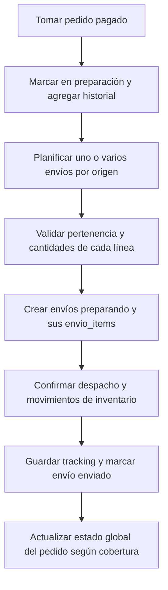

### Pasos

1. El backend exige autorización del operador y un pedido `pagado`. Cambia el pedido a `en_preparacion` y agrega `historial_estados_pedido` en la misma transacción.
2. Planifica uno o varios `envios` con `ubicacion_origen_id` y, cuando ya se conozca, `transportista_id`. La relación no única con el pedido permite el multienvío.
3. Asigna `envio_items` con cantidades positivas. La aplicación verifica que cada `pedido_item_id` pertenezca al mismo pedido del envío, que no haya duplicados lógicos y que las cantidades por envío y acumuladas no excedan lo pedido. Ninguna de esas tres reglas está garantizada por un constraint.
4. Registra los envíos inicialmente como `pendiente` o `preparando`. Al confirmar el despacho, consume las existencias o reservas según la política aplicada y escribe movimientos `salida` o `liberacion` sin descontar dos veces la misma unidad.
5. Guarda `numero_tracking`, `url_tracking` y `enviado_en` cuando el transportista confirme, y cambia el envío a `enviado`. Si la API externa falla, la aplicación reconcilia antes de repetir una solicitud que podría duplicar el despacho.
6. Cambia el pedido a `enviado` según la política de multienvío definida por el negocio y registra el historial. La base no deriva el estado global a partir de los envíos.

### Posibles estados finales

- Preparación iniciada: `pedidos.estado = 'en_preparacion'` y envíos `pendiente` o `preparando`.
- Despacho confirmado: envíos `enviado` y pedido `enviado` cuando la política de cobertura lo permita.
- Operación detenida antes del despacho: pedido `en_preparacion` sin cantidades ni movimientos parciales; una anulación explícita usa `cancelado` en el envío y, si corresponde al pedido completo, también en el pedido.

## Flujo 9: Seguimiento del envío mediante eventos

### Objetivo

Incorporar eventos del transportista, conservar su detalle y actualizar el estado logístico normalizado sin aceptar estados locales fuera del `CHECK`.

### Actores

Transportista o su API de tracking, backend Spring Boot y PostgreSQL/Supabase.

### Tablas involucradas

`transportistas`, `envios` y `envio_eventos`.

### Mermaid

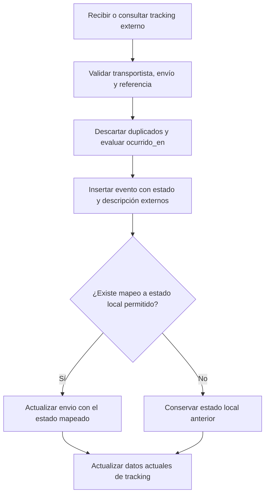

### Pasos

1. El backend obtiene eventos mediante la API externa o una notificación autorizada y localiza `envios` por tracking y transportista. `numero_tracking` tiene índice, pero no constraint de unicidad; una coincidencia ambigua requiere revisión.
2. Comprueba `referencia_externa`, contenido y `ocurrido_en` para no repetir eventos ni dejar que una notificación antigua revierta el progreso. La deduplicación es de aplicación porque no existe un `UNIQUE` para esa referencia.
3. Inserta `envio_eventos` con el estado recibido, descripción, ubicación, fecha de ocurrencia y referencia. `envio_eventos.estado` no tiene `CHECK` y puede conservar el vocabulario externo.
4. Mapea explícitamente el evento a uno de los estados permitidos de `envios`: `pendiente`, `preparando`, `enviado`, `en_transito`, `en_reparto`, `entregado`, `devuelto` o `cancelado`. Si no existe un mapeo confiable, conserva el estado local anterior.
5. Actualiza tracking y estado del envío en una transacción con la inserción del evento. La entrega completa del pedido se evalúa en el flujo siguiente, no por un trigger.

### Posibles estados finales

- Evento aplicado con `envios.estado = 'en_transito'` o `en_reparto`, entre otros valores permitidos por el `CHECK`.
- Evento de retorno o anulación con envío `devuelto` o `cancelado`, respectivamente.
- Evento duplicado, antiguo o desconocido registrado o descartado según la política, sin modificar el estado local a un valor inválido.

## Flujo 10: Entrega del pedido

### Objetivo

Confirmar la entrega de un envío y marcar el pedido como entregado únicamente cuando todas sus cantidades hayan sido cubiertas.

### Actores

Transportista, operador autorizado cuando existe confirmación manual, backend Spring Boot y PostgreSQL/Supabase.

### Tablas involucradas

`envios`, `envio_eventos`, `envio_items`, `pedido_items`, `pedidos` e `historial_estados_pedido`.

### Mermaid

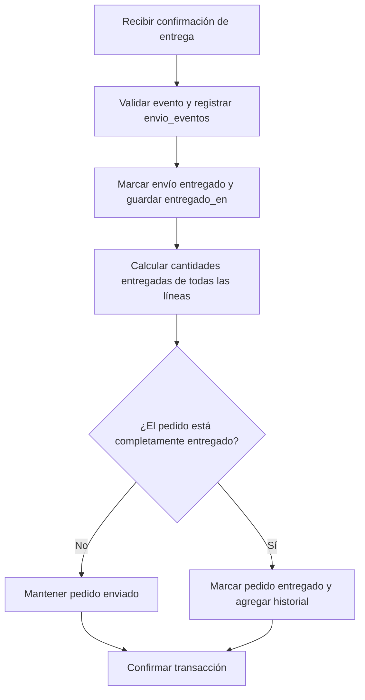

### Pasos

1. El backend valida la confirmación externa o el permiso del operador y registra `envio_eventos` con `ocurrido_en` y la referencia disponible.
2. Cambia `envios.estado` a `entregado` y completa `entregado_en`. No altera el pedido basándose únicamente en que un envío haya terminado.
3. En la misma transacción consulta las líneas del pedido y las cantidades de `envio_items` asociadas a envíos entregados. La aplicación calcula la cobertura por línea y considera posibles entregas parciales; PostgreSQL no declara una suma ni una comparación automática.
4. Si falta cualquier cantidad, mantiene el pedido `enviado`. Si la cobertura es completa y coherente, cambia el pedido a `entregado` y escribe `historial_estados_pedido`.
5. Una confirmación duplicada se reconoce por la referencia y el estado actual para no repetir historial ni retroceder estados.

### Posibles estados finales

- Entrega parcial: uno o varios envíos `entregado` y `pedidos.estado = 'enviado'`.
- Entrega completa: todos los envíos necesarios `entregado` y `pedidos.estado = 'entregado'`.
- Confirmación inválida o duplicada: sin nueva transición; se conservan los estados válidos existentes.

## Flujo 11: Reembolso

### Objetivo

Solicitar y confirmar una devolución asociada al pago y pedido correctos, sin exceder el saldo reembolsable ni confundir reembolsos parciales con totales.

### Actores

Cliente como solicitante, operador autorizado, backend Spring Boot, API externa de la pasarela y PostgreSQL/Supabase.

### Tablas involucradas

`pedidos`, `pagos`, `pasarelas_pago`, `reembolsos`, `historial_estados_pedido` y, para eventos del pago afectado, `pago_eventos`.

### Mermaid

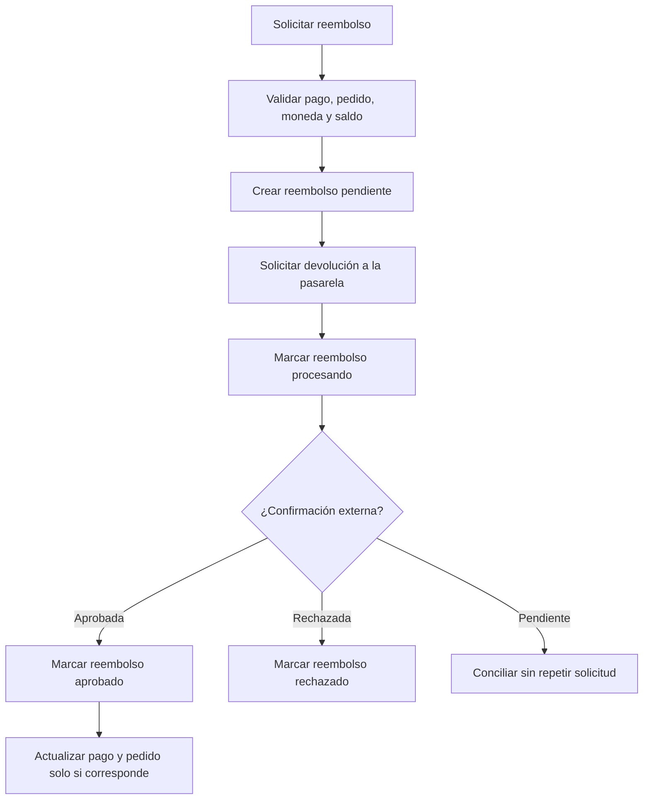

### Pasos

1. El backend comprueba autorización, que el pago pertenezca al pedido indicado, que exista saldo reembolsable y que monto y moneda sean coherentes. Las claves foráneas independientes de `reembolsos` no garantizan la pertenencia cruzada ni la suma máxima.
2. En una transacción bloquea el pago o el contexto de reembolso elegido por la aplicación, descuenta lógicamente las solicitudes en curso para evitar concurrencia excesiva e inserta `reembolsos` con estado `pendiente` y `monto > 0`.
3. Solicita la devolución a la API de la `pasarelas_pago` asociada al pago y guarda `transaccion_externa_id` cuando se reciba. Cambia el reembolso a `procesando` mientras espera confirmación.
4. Ante confirmación auténtica, marca el reembolso `aprobado` o `rechazado`. Si la respuesta es temporalmente incierta, lo mantiene en curso y concilia en vez de repetir ciegamente una operación monetaria.
5. Si se reembolsó la totalidad de un pago, actualiza ese pago a `reembolsado`; si fue parcial, conserva `aprobado` porque no existe estado parcial. Registra en `pago_eventos` el cambio del pago cuando corresponda.
6. Marca el pedido `reembolsado` únicamente cuando la política determine que el pedido completo fue devuelto, considerando todos sus pagos y reembolsos, y agrega el historial. En un reembolso parcial conserva el estado actual permitido del pedido y representa la devolución mediante las filas de `reembolsos`.

### Posibles estados finales

- `reembolsos.estado = 'pendiente'` o `procesando` mientras falta confirmación; pago y pedido conservan sus estados válidos.
- `reembolsos.estado = 'rechazado'` sin marcar como devueltos el pago o el pedido.
- Reembolso total confirmado: reembolso `aprobado`, pago `reembolsado` cuando todo ese pago fue devuelto y pedido `reembolsado` cuando la devolución completa así lo justifica.
- Reembolso parcial confirmado: reembolso `aprobado`, pago normalmente `aprobado` y pedido en su estado válido de cumplimiento, sin inventar un estado parcial.

## Flujo 12: Aplicación de descuento

### Objetivo

Validar y aplicar uno o varios descuentos durante el checkout, recalcular los totales y conservar su aplicación histórica al crear el pedido.

### Actores

CUSTOMER autenticado, backend Spring Boot y PostgreSQL/Supabase.

### Tablas involucradas

`descuentos`, `descuento_productos`, `descuento_colecciones`, `carrito_items`, `producto_variantes`, `coleccion_productos`, `checkout_sesiones`, `pedidos` y `pedido_descuentos`.

### Mermaid

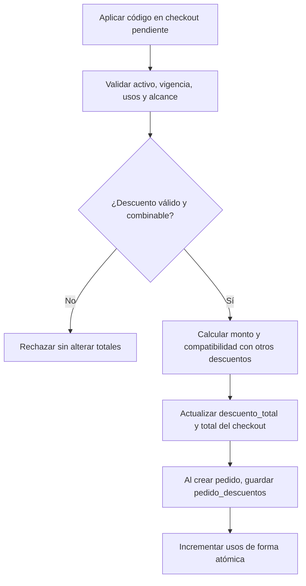

### Pasos

1. El backend busca `descuentos` por su `codigo` único y comprueba `activo = TRUE`, `inicia_en`, `termina_en` y disponibilidad frente a `uso_maximo`. Estas comparaciones temporales y de uso no están implementadas como constraints.
2. Determina las líneas elegibles a partir de `carrito_items` y `producto_variantes`, y consulta `descuento_productos`, `descuento_colecciones` y `coleccion_productos` cuando el descuento tenga alcance específico. La interpretación de un descuento sin filas de alcance debe ser uniforme en la aplicación.
3. Valida el `tipo` permitido: `porcentaje`, `monto_fijo` o `envio_gratis`. Para porcentajes, la aplicación impone el límite comercial pertinente porque el esquema solo exige `valor >= 0`.
4. Comprueba compatibilidad y no repetición con los demás descuentos de la sesión. La base no tiene una tabla de descuentos de carrito ni un `UNIQUE` pedido-descuento; el backend mantiene la selección durante el cálculo y evita duplicar aplicaciones al confirmar.
5. Calcula cada importe sin superar la base imponible o el envío según la política, y actualiza `checkout_sesiones.descuento_total` y `total`, manteniendo todos los importes no negativos. Los totales no se recalculan automáticamente.
6. Durante la creación del pedido, vuelve a validar todo con bloqueo, inserta una fila por aplicación en `pedido_descuentos` y actualiza `descuentos.usos_actuales` de forma atómica. Si el pedido no se confirma, no consume el uso; la política de cancelación o reembolso define cualquier reversión posterior.

### Posibles estados finales

- Descuento válido: `checkout_sesiones.estado = 'pendiente'` con `descuento_total` y `total` recalculados.
- Descuento inválido, vencido, agotado o incompatible: sin cambios en los totales ni incremento de `usos_actuales`.
- Pedido confirmado: checkout `completado`, pedido `pendiente` y aplicaciones persistidas en `pedido_descuentos`; un checkout cerrado sin conversión puede quedar `expirado` o `cancelado`.
